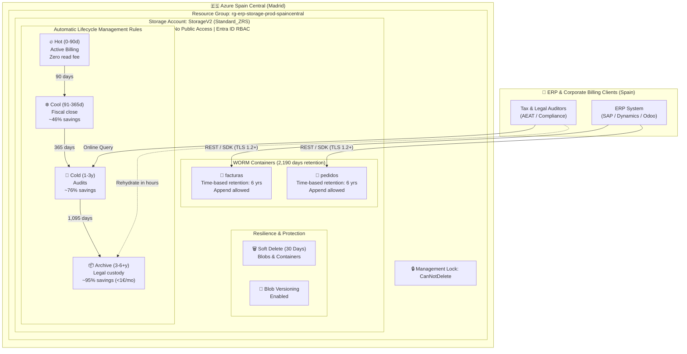

# Azure Blob Storage ERP WORM & Cost-Optimized Tiering (Spain Central)

[](https://github.com/nubenetes/azure-storage-erp-compliance-iac/actions/workflows/ci-lint-validate.yml)
[-0078D4?logo=microsoftazure)](https://azure.microsoft.com/explore/global-infrastructure/geographies/#spain)
[-844FBA?logo=terraform)](https://www.terraform.io/)
[](https://learn.microsoft.com/azure/azure-resource-manager/bicep/)
[](https://docs.ansible.com/)
[](https://learn.microsoft.com/powershell/azure/)
[](docs/LEGAL_COMPLIANCE_SPAIN.md)
[](LICENSE)

Enterprise reference architecture and multi-tool **Infrastructure as Code (IaC)** suite for storing and legally archiving ERP invoices and orders (up to 1 TB and scaling) in **Azure Blob Storage** within the **Spain Central (Madrid)** region.

This project delivers fully automated implementations across **Terraform / OpenTofu**, **Azure CLI**, **PowerShell (Az module)**, **Ansible**, and **Azure Bicep**.

> [!NOTE]
> **AI Architecture Reference & Disclaimer**
> 
> This repository and its Infrastructure as Code (IaC) solutions have been generated with **Gemini 3.8 Flash**.
> All templates, scripts, and configurations have been statically checked, formatted, and validated in CI (`terraform validate`, `az bicep build`, shell/PowerShell AST parser, and YAML linter), but **have not yet been deployed or tested in a live production environment**.
> 
> **Purpose**: This project serves as an **architectural reference blueprint, educational guide, and FinOps decision model**. It is designed to guide cloud architects and DevOps teams. Always test in a dedicated staging or sandbox subscription before executing permanent WORM policy locks in production.

---

## 🇪🇸 Resumen Ejecutivo (Español)

> [!NOTE]
> **Aviso de Referencia Arquitectónica Generada por IA**
> 
> Este repositorio y sus soluciones de Infraestructura como Código (IaC) han sido generados mediante **Gemini 3.8 Flash**.
> El código y las plantillas han superado validaciones automatizadas en CI (`terraform validate`, compilación `bicep`, análisis sintáctico de scripts Bash/PowerShell y YAML), pero **aún no han sido probados en un entorno de producción real**.
> 
> **Propósito**: Su objetivo es servir como **anteproyecto de arquitectura de referencia y modelo de decisión técnica**. Se recomienda encarecidamente validar los despliegues en suscripciones de prueba o staging antes de aplicar bloqueos irreversibles WORM en producción.

Para un sistema ERP en España (SAP, Microsoft Dynamics, Navision, Odoo o desarrollo propio), la arquitectura más eficiente y conforme a derecho consiste en:
1. **Cuenta Standard General Purpose v2 (`StorageV2`) con redundancia ZRS** (distribuida en las 3 zonas de disponibilidad de Madrid) o **LRS**, desplegada en la región **Spain Central (`spaincentral`)**.
2. **Políticas automáticas de ciclo de vida (Lifecycle Management)** con progresión de 4 niveles:
   - **Hot (0 – 90 días)**: Facturas y pedidos activos. Lectura inmediata sin coste por GB leído.
   - **Cool (91 – 365 días)**: Cierres trimestrales y anuales (~46% de ahorro en almacenamiento).
   - **Cold (366 – 1.095 días / 1 a 3 años)**: Auditorías puntuales (~76% de ahorro frente a Hot).
   - **Archive (1.096 – 2.190+ días / 3 a 6+ años)**: Custodia legal según el **Art. 30 del Código de Comercio** (~95% de ahorro, ~0,00099 €/GB/mes).
3. **Inmutabilidad WORM Legal**: Directiva de retención basada en tiempo de **2.190 días (6 años)** con soporte para anexar registros protegidos (`allowProtectedAppendWrites = true`), garantizando la inalterabilidad exigida por la **Ley Antifraude 11/2021** y el **Reglamento VeriFactu (RD 1007/2023)**.
4. **Resiliencia y Antiransomware**: Eliminación temporal (*Soft Delete*) de 30 días para blobs y contenedores, versionado de blobs y bloqueo de recurso de Azure de tipo `CanNotDelete`.

> 💡 **Impacto Financiero**: Esta arquitectura reduce el coste de almacenar 1 TB de unos **19,00 €/mes** en Hot Tier a tan solo **~4,37 €/mes (LRS)** o **~5,43 €/mes (ZRS con 3 zonas de disponibilidad)**, logrando un **ahorro recurrente superior al 75%** y garantizando el cumplimiento normativo mercantil y fiscal en España.

---

## 🏛️ Architecture Overview



---

## 📊 Detailed Cost Breakdown (1 TB over 6 Years)

| Access Tier / Phase | Storage Period | Effective Volume | LRS Price (€/GB/mo) | ZRS Price (€/GB/mo) | Monthly Cost (LRS) | Monthly Cost (ZRS) |
| :--- | :--- | :--- | :--- | :--- | :--- | :--- |
| **Hot** (Recent) | Days 0 – 90 | 41.67 GB | 0.0184 € | 0.0230 € | 0.77 € | 0.96 € |
| **Cool** (Fiscal Year) | Days 91 – 365 | 125.00 GB | 0.0100 € | 0.0125 € | 1.25 € | 1.56 € |
| **Cold** (Historical) | Years 1 – 3 | 333.33 GB | 0.0045 € | 0.0058 € | 1.50 € | 1.93 € |
| **Archive** (Statutory) | Years 3 – 6 | 500.00 GB | 0.00099 € | 0.00125 € | 0.50 € | 0.63 € |
| Operations & Lifecycle | Ongoing | ~14 GB/mo new | - | - | ~0.35 € | ~0.35 € |
| **Total Steady State** | **1,000 GB (1 TB)** | **100% of data** | - | - | **~4.37 € / mo** | **~5.43 € / mo** |

* Traditional 100% Hot Tier cost: **~18.80 € / mo (LRS)** or **~23.40 € / mo (ZRS)**.
* **Cumulative 6-year savings**: **~1,038.96 € saved per TB** (> 75% savings).
* Full financial modeling in [`docs/COST_OPTIMIZATION.md`](docs/COST_OPTIMIZATION.md).

---

## ⚖️ Legal & Regulatory Mapping (Spain & EU)

| Law / Regulation | Key Requirement | How This Architecture Complies |
| :--- | :--- | :--- |
| **Código de Comercio (Art. 30.1)** | Obligation to retain business books and invoices for **6 years**. | WORM retention policy set to **2,190 days** (6 calendar years). |
| **Ley General Tributaria (Ley 58/2003)** | General prescription of 4 years; 10 years for negative tax bases (BINs). | Data kept online (Hot $\rightarrow$ Cool $\rightarrow$ Cold) for 3 years, then archived at ultra-low cost. |
| **Ley Antifraude (Ley 11/2021)** | Guarantee **integrity, conservation, traceability, and inalterability**. | WORM policy prevents modifying or deleting blobs even by administrators. |
| **Reglamento VeriFactu (RD 1007/2023)**| Tamper-proof audit logs and chained hashes. | `allowProtectedAppendWrites = true` allows appending hash records securely. |
| **RGPD / LOPDGDD** | Sovereignty and data protection for personal details in invoices. | Deployed strictly in **Spain Central (Madrid)**; TLS 1.2+; Entra ID RBAC. |
| **ENS (Esquema Nacional de Seguridad)**| Level **ALTO** certification for public sector/regulated workloads. | Microsoft Azure Spain Central holds official **ENS Nivel Alto** certification. |

* In-depth legal analysis in [`docs/LEGAL_COMPLIANCE_SPAIN.md`](docs/LEGAL_COMPLIANCE_SPAIN.md).

---

## 🚀 Infrastructure as Code Solutions

This repository provides 5 ready-to-run IaC solutions. Choose the tool that best fits your platform engineering stack:

### 1. Terraform / OpenTofu

Located in [`terraform/`](terraform/). Validated against Terraform >= 1.5 and `azurerm` v4.

```bash
cd terraform
cp terraform.tfvars.example terraform.tfvars
terraform init
terraform plan
terraform apply
```

### 2. Azure CLI

Located in [`azure-cli/`](azure-cli/). POSIX bash script with idempotency and safety controls.

```bash
cd azure-cli
chmod +x deploy.sh lock-immutability.sh destroy.sh

# Deploy infrastructure (Unlocked test mode)
./deploy.sh -g rg-erp-compliance-prod -l spaincentral -r Standard_ZRS

# Once tested, permanently apply legal WORM lock (optional/production)
./lock-immutability.sh -g rg-erp-compliance-prod -s <storage_account_name> -c facturas
```

### 3. PowerShell (Az Module)

Located in [`powershell/`](powershell/). Enterprise PowerShell 7+ script with `-WhatIf` and Verbose support.

```powershell
cd powershell
# Deploy with 3-zone HA in Madrid
./Deploy-AzureStorageWORM.ps1 `
  -ResourceGroupName "rg-erp-storage-prod-spaincentral" `
  -Location "spaincentral" `
  -SkuName "Standard_ZRS" `
  -RetentionDays 2190
```

### 4. Ansible

Located in [`ansible/`](ansible/). Modular playbook using `azure.azcollection`.

```bash
cd ansible
ansible-galaxy collection install -r requirements.yml
ansible-playbook playbook.yml
```

### 5. Azure Bicep

Located in [`bicep/`](bicep/). Native modular Azure Bicep templates.

```bash
cd bicep
# Create resource group if needed
az group create --name rg-erp-storage-prod-spaincentral --location spaincentral

# Deploy using Bicep
az deployment group create \
  --resource-group rg-erp-storage-prod-spaincentral \
  --template-file main.bicep \
  --parameters main.bicepparam
```

### 6. Azure Portal (Manual / ClickOps)

Prefer a visual, step-by-step walkthrough in the Azure Portal GUI?
Check out the complete click-by-click operational guide:

📖 **[`docs/AZURE_PORTAL_CLICKOPS_GUIDE.md`](docs/AZURE_PORTAL_CLICKOPS_GUIDE.md)**

Includes exhaustive instructions covering:
- Resource Group & ZRS Storage Account creation in Spain Central.
- Zero-Trust security switches (TLS 1.2+, public access disabled).
- 30-day Soft Delete, versioning, and change feed enablement.
- `facturas` & `pedidos` containers with 2,190-day WORM retention policy.
- 4-phase Lifecycle Management tiering rule configuration.
- `CanNotDelete` Azure Resource Lock and test file validation.

---

## 🔒 Crucial Note on WORM Policy Locking

> [!CAUTION]
> **PERMANENT LEGAL LOCK IS IRREVERSIBLE**
> 
> By default, all 5 IaC templates and the portal guide deploy the 2,190-day retention policy in **Unlocked** state. This allows you to verify ingestion and integration tests safely.
> 
> Once you verify the deployment, you can permanently lock the policy using our dedicated tools (`lock-immutability.sh`, `Lock-ImmutabilityPolicy.ps1`, or setting `lock_immutability_policy = true`).
> 
> **Once LOCKED, neither you, your Global Admins, nor Microsoft Azure Support can delete or shorten the policy until 2,190 days elapse.**
> 
> Read the complete guide in [`docs/WORM_POLICY_LOCK_GUIDE.md`](docs/WORM_POLICY_LOCK_GUIDE.md).

---

## 📂 Repository Structure

```text
azure-storage-erp-compliance-iac/
├── .github/
│   └── workflows/
│       └── ci-lint-validate.yml        # CI pipeline validating Terraform, Bicep, Bash & PS
├── docs/
│   ├── ARCHITECTURE.md                 # Detailed architecture & Mermaid diagrams
│   ├── AZURE_PORTAL_CLICKOPS_GUIDE.md  # Click-by-click Azure Portal manual setup guide
│   ├── COST_OPTIMIZATION.md            # Mathematical TCO model for 1 TB in Spain Central
│   ├── LEGAL_COMPLIANCE_SPAIN.md       # Cód. Comercio, LGT, Ley Antifraude, VeriFactu, RGPD
│   └── WORM_POLICY_LOCK_GUIDE.md       # Step-by-step WORM Unlocked vs Locked guide
├── terraform/
│   ├── versions.tf                     # Provider constraints (AzureRM v4)
│   ├── main.tf                         # StorageV2, Containers, WORM, Lifecycle, Lock
│   ├── variables.tf                    # Parameter definitions & validations
│   ├── outputs.tf                      # Endpoints, IDs, policy status
│   └── terraform.tfvars.example        # Spain Central ZRS template
├── azure-cli/
│   ├── deploy.sh                       # Idempotent Bash deployment script
│   ├── lock-immutability.sh            # Safe interactive script to lock WORM policy
│   └── destroy.sh                      # Controlled cleanup script for test environments
├── powershell/
│   ├── Deploy-AzureStorageWORM.ps1     # PowerShell 7+ Az module automation
│   └── Lock-ImmutabilityPolicy.ps1     # Interactive PowerShell WORM lock script
├── ansible/
│   ├── requirements.yml                # azure.azcollection
│   ├── playbook.yml                    # Main orchestration playbook
│   └── roles/
│       └── azure_storage_worm/         # Modular Ansible role (tasks, defaults, meta)
├── bicep/
│   ├── main.bicep                      # Root Bicep template
│   ├── main.bicepparam                 # Parameter file for Spain Central
│   └── modules/                        # Modular resources (storage, containers, lifecycle, lock)
├── LICENSE                             # Apache-2.0 License
└── README.md                           # This documentation
```

---

## 🤝 Contributing

Contributions, issues, and feature requests are welcome! Feel free to check the [issues page](https://github.com/nubenetes/azure-storage-erp-compliance-iac/issues).

---

## 📜 License

Distributed under the **Apache License 2.0**. See [`LICENSE`](LICENSE) for more information.

---

## 📚 Public References & Official Documentation

This architecture, financial model, and legal compliance baseline are built upon the following official legislation, regulatory publications, and cloud engineering references:

### Spanish & European Legal Framework
- **Código de Comercio (Art. 30)**: [Real Decreto de 22 de agosto de 1885 por el que se publica el Código de Comercio (BOE-A-1885-6627)](https://www.boe.es/buscar/act.php?id=BOE-A-1885-6627#a30) — *Mandatory 6-year retention period for commercial documentation, correspondence, and books.*
- **Ley General Tributaria (LGT)**: [Ley 58/2003, de 17 de diciembre, General Tributaria (BOE-A-2003-23186)](https://www.boe.es/buscar/act.php?id=BOE-A-2003-23186) — *Articles 66–70 (4-year tax prescription) and Article 66 bis (10-year audit rights for deductions and negative tax bases / BINs).*
- **Ley Antifraude**: [Ley 11/2021, de 9 de julio, de medidas de prevención y lucha contra el fraude fiscal (BOE-A-2021-11473)](https://www.boe.es/buscar/act.php?id=BOE-A-2021-11473) — *Article 29.2.j establishing mandatory integrity, conservation, accessibility, legibility, traceability, and inalterability.*
- **Reglamento VeriFactu**: [Real Decreto 1007/2023, de 5 de diciembre (BOE-A-2023-24840)](https://www.boe.es/buscar/act.php?id=BOE-A-2023-24840) — *Technical regulations for computerized billing systems, hash chaining, electronic signatures, and tamper-proof event logs.*
- **Agencia Estatal de Administración Tributaria (AEAT)**: [Portal Oficial VeriFactu y Sistemas Informáticos de Facturación](https://sede.agenciatributaria.gob.es/Sede/procedimientoini/GZ28.shtml) — *Technical specifications, XML schemas, and verification web services.*
- **Reglamento General de Protección de Datos (RGPD)**: [Reglamento (UE) 2016/679 del Parlamento Europeo y del Consejo](https://eur-lex.europa.eu/legal-content/ES/TXT/?uri=CELEX%3A32016R0679) — *Territorial data sovereignty, European data residency, and legal obligation retention exemptions under Article 17.3.b.*

### Microsoft Azure Architecture & Security References
- **Azure Blob Storage Access Tiers**: [Hot, Cool, Cold, and Archive Access Tiers Overview](https://learn.microsoft.com/azure/storage/blobs/access-tiers-overview) — *Tier characteristics, retrieval latencies, and operation pricing models.*
- **Azure Blob Storage Lifecycle Management**: [Optimize costs by automatically managing the data lifecycle](https://learn.microsoft.com/azure/storage/blobs/lifecycle-management-overview) — *Rule engines, filters, tier transitions, and snapshot/version policies.*
- **Azure Immutable Storage (WORM)**: [Store business-critical blob data with immutable storage](https://learn.microsoft.com/azure/storage/blobs/immutable-storage-overview) — *Time-based retention policies, policy locking, legal holds, and regulatory compliance (SEC 17a-4(f), CFTC 1.31, FINRA).*
- **WORM Policy Locking Guidelines**: [Configure time-based retention policies for immutable blob data](https://learn.microsoft.com/azure/storage/blobs/immutable-time-based-retention-policy-how-to) — *Locking mechanics, ETag validation, and permanent compliance state.*
- **Azure Resource Locks**: [Lock resources to prevent unexpected changes](https://learn.microsoft.com/azure/azure-resource-manager/management/lock-resources) — *CanNotDelete management locks protecting infrastructure against human error and ransomware.*
- **Azure Spain Central Datacenter Region**: [Azure Geography: Spain Central (Madrid)](https://azure.microsoft.com/explore/global-infrastructure/geographies/#spain) — *3 availability zones, intra-country ultra-low latency (< 10 ms), and local interconnection.*
- **Esquema Nacional de Seguridad (ENS)**: [Azure Compliance Offering: Spain ENS (Nivel Alto)](https://learn.microsoft.com/compliance/regulatory/offering-spain-ens) — *Official accreditation under Real Decreto 311/2022 for regulated corporate and public workloads.*
- **Azure Storage Pricing Matrix**: [Azure Blob Storage Pricing in Spain Central](https://azure.microsoft.com/pricing/details/storage/blobs/) — *Official pricing calculator and per-GB rates for storage, writes, reads, and rehydration.*
