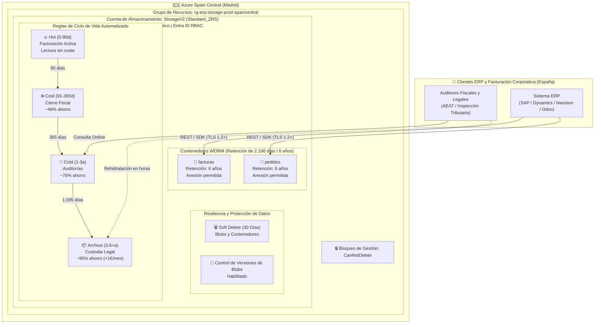

# Almacenamiento Azure Blob WORM para ERP y Ciclo de Vida Optimizado en Costes (Spain Central)

[](https://github.com/nubenetes/azure-storage-erp-compliance-iac/actions/workflows/ci-lint-validate.yml)
[-0078D4?logo=microsoftazure)](https://azure.microsoft.com/explore/global-infrastructure/geographies/#spain)
[-844FBA?logo=terraform)](https://www.terraform.io/)
[](https://learn.microsoft.com/azure/azure-resource-manager/bicep/)
[](https://docs.ansible.com/)
[](https://learn.microsoft.com/powershell/azure/)
[](docs/LEGAL_COMPLIANCE_SPAIN.md)
[](LICENSE)

Arquitectura de referencia empresarial y suite multiherramienta de **Infraestructura como Código (IaC)** para el almacenamiento y archivo legal inmutable de facturas y pedidos de ERP (hasta 1 TB y escalable) en **Azure Blob Storage** en la región **Spain Central (Madrid)**.

Este proyecto proporciona implementaciones automatizadas completas en **Terraform / OpenTofu**, **Azure CLI**, **PowerShell (módulo Az)**, **Ansible**, **Azure Bicep** y operación guiada en **Azure Portal (ClickOps)**.

> [!NOTE]
> **Aviso de Referencia Arquitectónica Generada por IA**
> 
> Este repositorio y sus soluciones de Infraestructura como Código (IaC) han sido generados mediante **Gemini 3.8 Flash**.
> Todo el código, plantillas y configuraciones han superado análisis estáticos, formateo y validación automatizada en integración continua (`terraform validate`, compilación `az bicep build`, analizadores sintácticos de AST para Shell y PowerShell, y linter de YAML), pero **aún no han sido desplegados ni sometidos a pruebas de carga en un entorno de producción real**.
> 
> **Propósito**: Este proyecto actúa como **anteproyecto de arquitectura de referencia, guía formativa y modelo de decisión técnica (FinOps)**. Está diseñado para orientar a arquitectos cloud y equipos de plataforma. Valide y pruebe siempre en una suscripción de pruebas (*sandbox/staging*) antes de aplicar bloqueos permanentes WORM en entornos productivos.

---

## 📑 Tabla de Contenidos

* [1. 🇪🇸 Resumen Ejecutivo](#-resumen-ejecutivo)
* [2. 🏛️ Diagrama de Arquitectura General](#️-diagrama-de-arquitectura-general)
  * [2.1. 🏛️ Las 3 Soluciones Arquitectónicas para ERP en España](#️-las-3-soluciones-arquitectónicas-para-erp-en-españa)
* [3. 📊 Desglose Detallado de Costes (1 TB a lo largo de 6 Años)](#-desglose-detallado-de-costes-1-tb-a-lo-largo-de-6-años)
* [4. ⚖️ Mapeo Normativo y Legal (España y Unión Europea)](#️-mapeo-normativo-y-legal-españa-y-unión-europea)
* [5. 📚 Suite de Documentación Técnica Especializada (docs/)](#-suite-de-documentación-técnica-especializada-docs)
* [6. 🚀 Soluciones de Infraestructura como Código (IaC)](#-soluciones-de-infraestructura-como-código-iac)
  * [6.1. Terraform / OpenTofu](#1-terraform--opentofu)
  * [6.2. Azure CLI](#2-azure-cli)
  * [6.3. PowerShell (Módulo Az)](#3-powershell-módulo-az)
  * [6.4. Ansible](#4-ansible)
  * [6.5. Azure Bicep](#5-azure-bicep)
  * [6.6. Azure Portal (Manual / ClickOps)](#6-azure-portal-manual--clickops)
* [7. 🔄 Automatización CI/CD Multiplataforma (GitHub, Azure DevOps, GitLab, Bitbucket)](#-automatización-cicd-multiplataforma-github-actions-azure-devops-gitlab-bitbucket)
* [8. 🧪 Operaciones Día 2, Pruebas Automatizadas y FinOps](#-operaciones-día-2-pruebas-automatizadas-y-finops)
* [9. 🔒 Advertencia Crítica sobre el Bloqueo de la Directiva WORM](#-advertencia-crítica-sobre-el-bloqueo-de-la-directiva-worm)
* [10. 📂 Estructura del Repositorio](#-estructura-del-repositorio)
* [11. 🎥 Sesiones Técnicas en Vídeo y Recursos Multimedia (YouTube)](#-sesiones-técnicas-en-vídeo-y-recursos-multimedia-youtube)
* [12. 📚 Referencias Públicas y Documentación Oficial](#-referencias-públicas-y-documentación-oficial)
* [13. 🤝 Contribuciones](#-contribuciones)
* [14. 📜 Licencia](#-licencia)

---

## 🇪🇸 Resumen Ejecutivo

Para un sistema ERP en España (SAP, Microsoft Dynamics, Navision, Odoo o desarrollo propio), la arquitectura más eficiente y conforme a derecho consiste en:
1. **Cuenta Standard General Purpose v2 (`StorageV2`) con redundancia ZRS** (distribuida en las 3 zonas de disponibilidad de Madrid) o **LRS**, desplegada en la región **Spain Central (`spaincentral`)**.
2. **Políticas automáticas de ciclo de vida (*Lifecycle Management*)** con progresión de 4 niveles:
   - **Hot (0 – 90 días)**: Facturas y pedidos activos. Lectura inmediata sin coste por GB leído.
   - **Cool (91 – 365 días)**: Cierres trimestrales y anuales (~46% de ahorro en almacenamiento).
   - **Cold (366 – 1.095 días / 1 a 3 años)**: Auditorías puntuales (~76% de ahorro frente a Hot).
   - **Archive (1.096 – 2.190+ días / 3 a 6+ años)**: Custodia legal según el **Art. 30 del Código de Comercio** (~95% de ahorro, ~0,00099 €/GB/mes).
3. **Inmutabilidad WORM Legal**: Directiva de retención basada en tiempo de **2.190 días (6 años)** con soporte para anexar registros protegidos (`allowProtectedAppendWrites = true`), garantizando la inalterabilidad exigida por la **Ley Antifraude 11/2021** y el **Reglamento VeriFactu (RD 1007/2023)**.
4. **Resiliencia y Antiransomware**: Eliminación temporal (*Soft Delete*) de 30 días para blobs y contenedores, versionado de blobs y bloqueo de recurso de Azure de tipo `CanNotDelete`.

> 💡 **Impacto Financiero**: Esta arquitectura reduce el coste de almacenar 1 TB de unos **19,00 €/mes** en Hot Tier a tan solo **~4,37 €/mes (LRS con Archive)** o **~7,70 €/mes (ZRS distribuido en 3 zonas de disponibilidad físicas con Cold online)**, logrando un **ahorro recurrente de hasta el 76,8%** y garantizando el cumplimiento normativo mercantil y fiscal en España. *(Nota: el nivel Archive no está soportado en ZRS por diseño de Azure, por lo que en ZRS los datos históricos se conservan en Cold en línea a milisegundos sin coste de rehidratación)*.

---

## 🏛️ Diagrama de Arquitectura General



### 🏛️ Las 3 Soluciones Arquitectónicas para ERP en España

Debido a que **el nivel Archive no está soportado en cuentas con redundancia ZRS en Azure**, esta solución proporciona 3 patrones de implementación según las prioridades del negocio:

| Solución / Patrón | Redundancia | Progresión de Niveles | Coste (1 TB) | Ventaja Diferencial | Cuándo Elegirla |
| :--- | :---: | :--- | :---: | :--- | :--- |
| **1. Mínimo Coste TCO (Archive WORM)** | `Standard_LRS` | Hot $\rightarrow$ Cool $\rightarrow$ Cold $\rightarrow$ **Archive** | **~4,37 € / mes** | **Máximo ahorro FinOps (76,8%)** con custodia a céntimos en cinta offline. | Empresas donde optimizar costes es la prioridad #1. Rehidratación en 3-15h (~3,33 €/100 GB). |
| **2. Máxima Resiliencia 3 Zonas (Cold WORM)** | `Standard_ZRS` | Hot $\rightarrow$ Cool $\rightarrow$ **Cold (1-6 años)** | **~7,70 € / mes** | **100% online inmediato (<10 ms)**, tolerancia a caída de centro de datos, **0 € rehidratación**. | Entornos de producción de misión crítica, banca, y requerimientos de inspección inmediata. |
| **3. Modelo Enterprise Desacoplado Dual** | `Standard_ZRS` + `Standard_LRS` | Años 0-3 en ZRS (Hot/Cool)<br/>Años 3-6 en LRS (Archive) | **~5,30 € / mes** | **Lo mejor de ambos mundos**: 3 zonas para años activos y Archive ultra-barato para histórico. | Corporaciones con altos volúmenes (>10 TB) con script de sincronización [`sync-dual-account-archive.sh`](scripts/sync-dual-account-archive.sh). |

> 📖 **Documentación Técnica Completa**: Consulte el desglose detallado, diagramas de flujo y matrices de decisión en [**`docs/ARCHITECTURE.md` (Sección 4)**](docs/ARCHITECTURE.md#4-las-3-soluciones-arquitectónicas-para-erp-en-españa-comparativa-exhaustiva-e-implementación).

---

## 📊 Desglose Detallado de Costes (1 TB a lo largo de 6 Años)

| Nivel de Acceso / Fase | Periodo de Custodia | Volumen Efectivo | Tarifa LRS (€/GB/mes) | Tarifa ZRS (€/GB/mes) | Coste Mensual (LRS - 4 Niveles) | Coste Mensual (ZRS - 3 Niveles) |
| :--- | :--- | :--- | :--- | :--- | :--- | :--- |
| **Hot** (Facturación reciente) | Días 0 – 90 | 41,67 GB | 0,0184 € | 0,0230 € | 0,77 € | 0,96 € |
| **Cool** (Ejercicio fiscal) | Días 91 – 365 | 125,00 GB | 0,0100 € | 0,0125 € | 1,25 € | 1,56 € |
| **Cold** (Histórico contable) | Años 1 – 3 (LRS) / 1 – 6 (ZRS) | 333,33 GB (LRS) / 833,33 GB (ZRS) | 0,0045 € | 0,0058 € | 1,50 € | 4,83 € |
| **Archive** (Custodia legal) | Años 3 – 6 | 500,00 GB (LRS) / N/A (ZRS) | 0,00099 € | *No soportado en ZRS* | 0,50 € | 0,00 € |
| Operaciones y transiciones | Continuo | ~14 GB/mes nuevo | - | - | ~0,35 € | ~0,35 € |
| **Coste Total en Régimen Estable** | **1.000 GB (1 TB)** | **100% de los datos** | - | - | **~4,37 € / mes** | **~7,70 € / mes** |

* Coste tradicional manteniendo todo en Hot: **~18,80 € / mes (LRS)** o **~23,40 € / mes (ZRS)**.
* **Ahorro acumulado a 6 años**: **~1.038,96 € ahorrados en LRS** (> 76% de ahorro) y **~1.130,40 € ahorrados en ZRS** (> 67% de ahorro con 3 AZs en Madrid y 100% online).
* **Coste de Rehidratación ante Inspección / Auditoría**: En LRS, tan solo **~3,33 € por cada lote de 100 GB** (~20.000 facturas) en prioridad estándar (3-15h) o **~5,77 € por 50 GB** en alta prioridad (<1h). En ZRS, **0,00 € de coste de rehidratación y 0 horas de espera**, ya que los datos residen en el nivel *Cold* en línea con acceso inmediato en milisegundos.
* Modelado financiero exhaustivo y 4 ejemplos numéricos disponibles en [`docs/COST_OPTIMIZATION.md`](docs/COST_OPTIMIZATION.md#5-análisis-detallado-de-costes-de-rehidratación-y-ejemplos-prácticos).

---

## ⚖️ Mapeo Normativo y Legal (España y Unión Europea)

| Norma / Marco Legal | Requisito Principal | Cómo lo Cumple esta Arquitectura |
| :--- | :--- | :--- |
| **Código de Comercio (Art. 30.1)** | Obligación de conservar libros, correspondencia y justificantes durante **6 años**. | Directiva inmutable WORM configurada exactamente a **2.190 días** (6 años naturales). |
| **Ley General Tributaria (Ley 58/2003)** | Prescripción general de 4 años; 10 años para bases imponibles negativas (BINs). | Acceso online inmediato (Hot $\rightarrow$ Cool $\rightarrow$ Cold) durante 3 años y archivo de coste marginal (<1 €). |
| **Ley Antifraude (Ley 11/2021)** | Garantizar la **integridad, conservación, accesibilidad, legibilidad, trazabilidad e inalterabilidad**. | Directiva WORM bloqueada que impide el borrado o alteración incluso a administradores de suscripción. |
| **Reglamento VeriFactu (RD 1007/2023)**| Trazas de auditoría inalterables y hashes encadenados. | `allowProtectedAppendWrites = true` permite anexar registros hash y logs sin sobreescribir. |
| **RGPD / LOPDGDD** | Soberanía del dato y protección de datos personales de autónomos y clientes. | Datos alojados estrictamente en **Spain Central (Madrid)**; TLS 1.2+; autenticación Entra ID RBAC. |
| **Esquema Nacional de Seguridad (ENS)**| Certificación nivel **ALTO** para entidades reguladas y sector público. | Microsoft Azure Spain Central dispone de la certificación oficial **ENS Nivel Alto**. |

> [!CAUTION]
> **Régimen Sancionador y Riesgo Económico si no hay WORM**:
> La tenencia de sistemas de almacenamiento o facturación que permitan alterar, manipular o eliminar facturas sin bloqueo inmutable conlleva una **multa fija de 50.000 € por ejercicio económico** (Art. 201 bis LGT - Ley Antifraude / VeriFactu), acumulando **hasta 200.000 €** en una inspección estándar de 4 ejercicios fiscales.
> Asimismo, acarrea sanciones del **2% al 5% de la facturación** por falta de custodia (Art. 201 LGT), la **expulsión de deducciones de IVA e Impuesto sobre Sociedades** (con sanciones del 50% al 150% de la cuota) y la **calificación de Concurso Culpable** con responsabilidad patrimonial personal e ilimitada para los administradores societarios (Arts. 443-444 Ley Concursal).
> 
> Consulte el análisis sancionador detallado en [`docs/LEGAL_COMPLIANCE_SPAIN.md`](docs/LEGAL_COMPLIANCE_SPAIN.md#3-régimen-sancionador-costes-y-penalizaciones-económicas-por-incumplimiento-worm).

---

## 📚 Suite de Documentación Técnica Especializada (`docs/`)

Para profundizar en cada vertiente del proyecto (arquitectura, marco legal y sanciones, finanzas FinOps y rehidratación, seguridad WORM, portal ClickOps, telemetría KQL e integración ERP), navegue a través de la suite de guías técnicas enlazadas:

| Documento | Ámbito y Temática Principal | Navegación Directa |
| :--- | :--- | :--- |
| 🏛️ **Arquitectura Técnica** | Diagramas de componentes, topología en `spaincentral`, resiliencia ZRS de 3 zonas y reglas de ciclo de vida. | [Consultar Guía →](docs/ARCHITECTURE.md) |
| ⚖️ **Marco Legal y Régimen Sancionador** | Fundamentos normativos: Código de Comercio (Art. 30), LGT, Ley Antifraude 11/2021, VeriFactu y **multas de hasta 200.000 € si no hay WORM**. | [Consultar Guía →](docs/LEGAL_COMPLIANCE_SPAIN.md) |
| 💰 **Optimización de Costes y Rehidratación** | Justificación del ahorro (~71-76%) y **análisis exhaustivo con 4 ejemplos numéricos de costes de rehidratación desde Archive**. | [Consultar Guía →](docs/COST_OPTIMIZATION.md) |
| 🔒 **Guía Operativa del Bloqueo WORM** | Mecánica de inmutabilidad irreversible, estados *Unlocked* vs *Locked*, lista de control previa y comandos de bloqueo. | [Consultar Guía →](docs/WORM_POLICY_LOCK_GUIDE.md) |
| 🖱️ **Manual en Azure Portal (ClickOps)** | Manual paso a paso en 8 fases a través de la interfaz web gráfica del Portal de Azure con nombres en español e inglés. | [Consultar Guía →](docs/AZURE_PORTAL_CLICKOPS_GUIDE.md) |
| 📊 **Auditoría, Monitorización y KQL** | Configuración de diagnósticos a Log Analytics Workspace y 4 consultas KQL para inspecciones tributarias y RGPD. | [Consultar Guía →](docs/AUDITING_AND_MONITORING.md) |
| 🔌 **Integración ERP y Rehidratación** | Autenticación Zero Trust mediante Entra ID RBAC, etiquetas de índice (*Blob Index Tags*) y rehidratación desde Archive. | [Consultar Guía →](docs/ERP_INTEGRATION_AND_REHYDRATION.md) |
| 🚀 **Automatización CI/CD Multiplataforma** | Pipelines con OIDC (sin secretos) en GitHub Actions, Azure DevOps, GitLab CI y Bitbucket con decomisión segura. | [Consultar Guía →](docs/CICD_AUTOMATION_GUIDE.md) |

---

## 🚀 Soluciones de Infraestructura como Código (IaC)

Este repositorio incluye 6 opciones listas para ejecutar. Seleccione la que mejor se adapte al stack de su organización:

### 1. Terraform / OpenTofu

Ubicado en [`terraform/`](terraform/). Validado contra Terraform >= 1.5 y el proveedor `azurerm` v4.

```bash
cd terraform
cp terraform.tfvars.example terraform.tfvars
terraform init
terraform plan
terraform apply
```

### 2. Azure CLI

Ubicado en [`azure-cli/`](azure-cli/). Script en Bash POSIX con controles de idempotencia y seguridad.

```bash
cd azure-cli
chmod +x deploy.sh lock-immutability.sh destroy.sh

# Despliegue de la infraestructura (modo de prueba Unlocked)
./deploy.sh -g rg-erp-compliance-prod -l spaincentral -r Standard_ZRS

# Tras validar la ingesta, bloqueo legal permanente WORM (producción)
./lock-immutability.sh -g rg-erp-compliance-prod -s <nombre_storage_account> -c facturas
```

### 3. PowerShell (Módulo Az)

Ubicado en [`powershell/`](powershell/). Script para PowerShell 7+ con soporte para `-WhatIf` y modo detallado.

```powershell
cd powershell
# Despliegue con alta disponibilidad de 3 zonas en Madrid
./Deploy-AzureStorageWORM.ps1 `
  -ResourceGroupName "rg-erp-storage-prod-spaincentral" `
  -Location "spaincentral" `
  -SkuName "Standard_ZRS" `
  -RetentionDays 2190
```

### 4. Ansible

Ubicado en [`ansible/`](ansible/). Playbook y rol modular mediante la colección oficial `azure.azcollection`.

```bash
cd ansible
ansible-galaxy collection install -r requirements.yml
ansible-playbook playbook.yml
```

### 5. Azure Bicep

Ubicado en [`bicep/`](bicep/). Plantillas nativas modulares de Azure Bicep.

```bash
cd bicep
# Crear el grupo de recursos si es necesario
az group create --name rg-erp-storage-prod-spaincentral --location spaincentral

# Desplegar mediante Bicep
az deployment group create \
  --resource-group rg-erp-storage-prod-spaincentral \
  --template-file main.bicep \
  --parameters main.bicepparam
```

### 6. Azure Portal (Manual / ClickOps)

¿Prefiere una guía visual paso a paso para operar directamente en el portal web?  
Consulte el manual operativo click por click:

📖 **[`docs/AZURE_PORTAL_CLICKOPS_GUIDE.md`](docs/AZURE_PORTAL_CLICKOPS_GUIDE.md)**

Incluye instrucciones minuciosas que cubren:
- Creación del Grupo de Recursos y Cuenta de Almacenamiento ZRS en Spain Central.
- Ajustes de seguridad Zero Trust (TLS 1.2+, acceso público deshabilitado).
- Activación de Soft Delete de 30 días, versionado de blobs y fuente de cambios (*Change Feed*).
- Creación de los contenedores `facturas` y `pedidos` con directiva WORM de 2.190 días.
- Configuración de las 4 fases de ciclo de vida en *Lifecycle Management*.
- Aplicación del bloqueo de recurso `CanNotDelete` y prueba de rechazo de borrado.

---

## 🔄 Automatización CI/CD Multiplataforma (GitHub Actions, Azure DevOps, GitLab, Bitbucket)

Todas las soluciones de Infraestructura como Código (IaC) de este repositorio están preparadas para ser orquestadas no solo localmente por CLI, sino de forma 100% automatizada y declarativa a través de pipelines modernos de CI/CD empresariales, utilizando **federación de identidades OIDC con Microsoft Entra ID (Zero Trust sin contraseñas)**:

```text
       PR / Commit                     Aprobación Manual              Día 2 & Decomisión
  [Lint & Validación]  ──────────►  [Puerta en Entorno]  ──────────►  [Compliance Test]
  [Terraform Plan]                  [Deploy / Apply]                  [Destroy Seguro con Lock Release]
  [Bicep What-If]                   [Región Spain Central]
```

### Pipelines Listos para Producción Incluidos:

1. **GitHub Actions** ([`.github/workflows/`](.github/workflows/)):
   * [`deploy-terraform.yml`](.github/workflows/deploy-terraform.yml): Plan automático en Pull Requests, Apply con entorno de producción y Destroy manual con frase de seguridad `CONFIRM-DECOMMISSION-ERP-STORAGE`.
   * [`deploy-bicep.yml`](.github/workflows/deploy-bicep.yml): What-If en PRs y despliegue idempotente a `spaincentral`.
   * [`deploy-iac-orchestrator.yml`](.github/workflows/deploy-iac-orchestrator.yml): Orquestador con selector para Azure CLI, PowerShell, Ansible, Bicep y Terraform.
2. **Azure DevOps Pipelines** ([`azure-pipelines/`](azure-pipelines/)):
   * [`azure-pipelines-terraform.yml`](azure-pipelines/azure-pipelines-terraform.yml): Pipeline YAML multi-etapa (`ValidateAndPlan` $\rightarrow$ `DeployProduction` $\rightarrow$ `DecommissionSafe`) con Service Connection federada OIDC.
   * [`azure-pipelines-bicep.yml`](azure-pipelines/azure-pipelines-bicep.yml): Tareas nativas de Bicep y despliegue a Resource Group.
   * [`azure-pipelines-orchestrator.yml`](azure-pipelines/azure-pipelines-orchestrator.yml): Automatización para Ansible, PowerShell Az y Azure CLI.
3. **GitLab CI/CD** ([`.gitlab-ci.yml`](.gitlab-ci.yml)):
   * Pipeline declarativo con `id_tokens` para Azure OIDC, etapas de `plan`, `deploy` (manual) y `decommission` en [`.gitlab/ci/`](.gitlab/ci/).
4. **Bitbucket Pipelines** ([`bitbucket-pipelines.yml`](bitbucket-pipelines.yml)):
   * Flujo con `oidc: true`, pasos de validación en Pull Requests y puertas de despliegue a producción.

📖 **Guía Completa de Configuración**: Consulte el manual paso a paso con configuración de identidades federadas Entra ID y salvaguardas de decomisión en:  
👉 **[`docs/CICD_AUTOMATION_GUIDE.md`](docs/CICD_AUTOMATION_GUIDE.md)**

---

## 🧪 Operaciones Día 2, Pruebas Automatizadas y FinOps

Más allá del aprovisionamiento, este repositorio incluye utilidades operativas para el mantenimiento del entorno:

### 1. Suite Automatizada de Verificación de Cumplimiento WORM
Comprueba que el entorno cumple al 100% las normativas antes de subir facturas reales:
* **Bash**: `./scripts/test-worm-compliance.sh -s <storage_account> -g <resource_group>`
* **PowerShell**: `./scripts/Test-WORMCompliance.ps1 -StorageAccountName <storage_account> -ResourceGroupName <resource_group>`

Ejecuta **6 aserciones automáticas**:
1. Ingesta de blob en bloque.
2. Rechazo estricto de sobrescritura (`BlobImmutableDueToPolicy`).
3. Rechazo estricto de borrado bajo directiva WORM.
4. Verificación de anexión protegida (`allowProtectedAppendWrites = true` para VeriFactu).
5. Comprobación de Soft Delete de 30 días y control de versiones.
6. Auditoría del bloqueo de administración de Azure `CanNotDelete`.

### 2. Simulador Interactivo de Costes FinOps (TCO)
Calcule proyecciones de ahorro personalizadas según el volumen de facturación de su empresa:
```bash
python3 scripts/calculate-erp-storage-tco.py --volume-gb 1000 --sku ZRS --years 6
```

### 3. Guía de Auditoría Tributaria y Consultas KQL (*Log Analytics*)
Manual completo en [`docs/AUDITING_AND_MONITORING.md`](docs/AUDITING_AND_MONITORING.md):
* Consultas KQL prediseñadas para detectar intentos no autorizados de borrado o manipulación.
* Seguimiento de solicitudes de rehidratación desde el nivel *Archive*.
* Registro de accesos por dirección IP e identidad conforme al Art. 30 del RGPD.

### 4. Ejemplos de Código para Integración de ERPs y Rehidratación
Guía técnica en [`docs/ERP_INTEGRATION_AND_REHYDRATION.md`](docs/ERP_INTEGRATION_AND_REHYDRATION.md):
* **Python**: [`examples/python/upload_verifactu_invoice.py`](examples/python/upload_verifactu_invoice.py) (Entra ID RBAC + etiquetas de índice).
* **C# / .NET 8**: [`examples/csharp/InvoiceStorageService.cs`](examples/csharp/InvoiceStorageService.cs) (Servicio desacoplado para ERPs).
* **cURL / REST**: [`examples/curl/rehydrate_archive_blob.sh`](examples/curl/rehydrate_archive_blob.sh) (Llamada REST directa para rehidratar).

### 5. Gestión de Bloqueos Legales Temporales (*Legal Hold* para Inspecciones de la AEAT)
Congele de forma indefinida documentos afectados por una inspección tributaria sin alterar la retención por tiempo:
* **Bash**: `./azure-cli/legal-hold.sh -s <storage_account> -c facturas --action set --tag aeat-expediente-2026`
* **PowerShell**: `./powershell/Set-AzureStorageLegalHold.ps1 -StorageAccountName <storage_account> -ResourceGroupName <resource_group> -Tag aeat-expediente-2026`

---

## 🔒 Advertencia Crítica sobre el Bloqueo de la Directiva WORM

> [!CAUTION]
> **EL BLOQUEO LEGAL PERMANENTE ES IRREVERSIBLE**
> 
> Por defecto, todas las plantillas IaC y la guía del portal despliegan la directiva de retención de 2.190 días en estado **Desbloqueado (Unlocked)**. Esto permite verificar la ingesta y realizar pruebas de integración con total seguridad.
> 
> Una vez comprobado el correcto funcionamiento, puede bloquear permanentemente la directiva mediante las herramientas provistas (`lock-immutability.sh`, `Lock-ImmutabilityPolicy.ps1` o estableciendo `lock_immutability_policy = true`).
> 
> **Una vez BLOQUEADA (Locked), ni usted, ni los Administradores Globales, ni el equipo de soporte técnico de Microsoft Azure podrán eliminar o acortar la directiva hasta transcurridos los 2.190 días.**
> 
> Lea la guía operativa completa en [`docs/WORM_POLICY_LOCK_GUIDE.md`](docs/WORM_POLICY_LOCK_GUIDE.md).

---

## 📂 Estructura del Repositorio

```text
azure-storage-erp-compliance-iac/
├── .github/
│   └── workflows/
│       ├── ci-lint-validate.yml        # Pipeline de CI (Terraform, Bicep, Bash, PS y YAML)
│       ├── deploy-terraform.yml        # CI/CD GitHub Actions: Plan, Apply y Destroy (OIDC)
│       ├── deploy-bicep.yml            # CI/CD GitHub Actions: Bicep What-If y Deploy (OIDC)
│       └── deploy-iac-orchestrator.yml # Orquestador multi-herramienta (CLI, PS, Ansible)
├── azure-pipelines/
│   ├── azure-pipelines-terraform.yml   # Pipeline Azure DevOps multi-etapa con Service Connection
│   ├── azure-pipelines-bicep.yml       # Pipeline Azure DevOps para Bicep
│   └── azure-pipelines-orchestrator.yml# Orquestador Azure DevOps para CLI, PS y Ansible
├── .gitlab-ci.yml                      # Pipeline raíz de GitLab CI/CD con id_tokens OIDC
├── .gitlab/
│   └── ci/
│       ├── terraform.gitlab-ci.yml     # Jobs de Terraform (plan, apply, destroy manual)
│       └── bicep-azurecli.gitlab-ci.yml# Jobs de Bicep, Azure CLI y compliance test
├── bitbucket-pipelines.yml             # Pipeline Atlassian Bitbucket con OIDC y manual gates
├── docs/
│   ├── ARCHITECTURE.md                 # Arquitectura detallada con diagramas Mermaid
│   ├── AUDITING_AND_MONITORING.md      # Consultas KQL y configuración de diagnósticos
│   ├── AZURE_PORTAL_CLICKOPS_GUIDE.md  # Manual operativo paso a paso en Azure Portal
│   ├── CICD_AUTOMATION_GUIDE.md        # Manual de CI/CD: OIDC, GitHub, ADO, GitLab, Bitbucket
│   ├── COST_OPTIMIZATION.md            # Modelo financiero y TCO para 1 TB en Spain Central
│   ├── ERP_INTEGRATION_AND_REHYDRATION.md # Guía para desarrolladores de integración y rehidratación
│   ├── LEGAL_COMPLIANCE_SPAIN.md       # Cód. Comercio, LGT, Ley Antifraude, VeriFactu, RGPD
│   └── WORM_POLICY_LOCK_GUIDE.md       # Guía de estados Unlocked vs Locked y seguridad
├── terraform/
│   ├── versions.tf                     # Restricciones de proveedores (AzureRM v4)
│   ├── main.tf                         # StorageV2, Contenedores, WORM, Ciclo de vida, Candado
│   ├── variables.tf                    # Definición de variables tipadas y validaciones
│   ├── outputs.tf                      # Endpoints, identificadores y estado WORM
│   └── terraform.tfvars.example        # Plantilla configurada para Spain Central ZRS
├── azure-cli/
│   ├── deploy.sh                       # Script de despliegue automatizado e idempotente
│   ├── legal-hold.sh                   # Script para fijar y liberar bloqueos legales de la AEAT
│   ├── lock-immutability.sh            # Script interactivo y seguro para el bloqueo WORM
│   └── destroy.sh                      # Script de desmantelamiento controlado para tests
├── powershell/
│   ├── Deploy-AzureStorageWORM.ps1     # Automatización con PowerShell 7+ y módulo Az
│   ├── Lock-ImmutabilityPolicy.ps1     # Script interactivo de bloqueo en PowerShell
│   └── Set-AzureStorageLegalHold.ps1   # Gestión de bloqueos legales en PowerShell
├── ansible/
│   ├── requirements.yml                # Colección azure.azcollection
│   ├── playbook.yml                    # Playbook orquestador principal
│   └── roles/
│       └── azure_storage_worm/         # Rol modular de Ansible (tasks, defaults, meta)
├── bicep/
│   ├── main.bicep                      # Orquestador principal de Bicep
│   ├── main.bicepparam                 # Archivo de parámetros para Spain Central ZRS
│   └── modules/                        # Módulos: storage, containers, lifecycle, lock
├── scripts/
│   ├── test-worm-compliance.sh         # Suite automatizada de pruebas de cumplimiento (Bash)
│   ├── Test-WORMCompliance.ps1         # Suite automatizada de pruebas de cumplimiento (PowerShell)
│   ├── calculate-erp-storage-tco.py    # Calculador CLI interactivo de costes FinOps
│   └── sync-dual-account-archive.sh    # Sincronización enterprise ZRS -> LRS Archive (Solución 3)
├── examples/
│   ├── python/upload_verifactu_invoice.py # Ejemplo en Python con Entra ID y etiquetas VeriFactu
│   ├── csharp/InvoiceStorageService.cs     # Servicio empresarial en C# / .NET 8 para ERPs
│   └── curl/rehydrate_archive_blob.sh     # Script en cURL para rehidratación vía API REST
├── LICENSE                             # Licencia Apache-2.0
└── README.md                           # Documentación principal
```

---

## 🎥 Sesiones Técnicas en Vídeo y Recursos Multimedia (YouTube)

La arquitectura de almacenamiento inmutable WORM, las estrategias FinOps de ciclo de vida y los protocolos de cumplimiento legal para sistemas ERP en Azure Spain Central cuentan con una serie audiovisual dedicada sintetizada con **Gemini NotebookLM**.

Todos los episodios y vídeos técnicos están disponibles en el canal oficial de YouTube [**@nubenetes**](https://youtube.com/@nubenetes).

> [!NOTE]
> **Experiencia de Aprendizaje en Español 🇪🇸**:
> Todo el contenido audiovisual cuenta con locución nativa en **español** y subtítulos traducidos automáticamente (CC) a más de **20 idiomas** para equipos multinacionales de arquitectura cloud, FinOps y ciberseguridad.

### 📊 Colección de Vídeos Técnicos y Recursos Audiovisuales (5 Entregas)

| Formato | Episodio / Título | Enfoque / Dominio Técnico | Idioma | Duración | Enlace Directo en YouTube |
|:---:|---|---|:---:|:---:|---|
| 📽️ **Vídeo Guía** | [**Azure Storage WORM Optimizado: Arquitectura y Cumplimiento Legal en Spain Central**](https://www.youtube.com/watch?v=IZBAQg3kP7c) | **Arquitectura Global**: Spain Central, WORM, VeriFactu, retención a 6 años y protección de datos | 🇪🇸 Español *(CC 20+)* | `7:57` | [▶️ Ver Vídeo](https://www.youtube.com/watch?v=IZBAQg3kP7c) |
| 📽️ **Vídeo Guía** | [**Azure ERP: Más del 75% de Ahorro FinOps con Ciclo de Vida y Storage WORM**](https://www.youtube.com/watch?v=Ck36Qyz0QJs) | **Ingeniería FinOps**: TCO para 1 TB, progresión Hot a Archive y ahorro neto del 75% | 🇪🇸 Español *(CC 20+)* | `6:00` | [▶️ Ver Vídeo](https://www.youtube.com/watch?v=Ck36Qyz0QJs) |
| 📽️ **Vídeo Guía** | [**FinOps y WORM en Azure: Custodia Legal de Facturas sin Sobrecostes Cloud**](https://www.youtube.com/watch?v=A28ztMSJuPc) | **Marco Normativo & Sanciones**: Art. 30 Cód. Comercio, Ley Antifraude y bloqueo Policy Lock | 🇪🇸 Español *(CC 20+)* | `8:36` | [▶️ Ver Vídeo](https://www.youtube.com/watch?v=A28ztMSJuPc) |
| 📽️ **Vídeo Guía** | [**Coste y Estrategia de Rehidratación en Azure WORM: De Archive a Auditoría**](https://www.youtube.com/watch?v=RoGpL_4YGkA) | **Operaciones de Rehidratación**: Costes por lote de 100 GB, SLAs Estándar vs Alta Prioridad | 🇪🇸 Español *(CC 20+)* | `7:34` | [▶️ Ver Vídeo](https://www.youtube.com/watch?v=RoGpL_4YGkA) |
| ⚡ **Short Técnico** | [**Cómo Archivar Facturas Seis Años en Azure sin Arruinarte**](https://www.youtube.com/shorts/7ZerGBHznr8) | **Píldora Rápida**: Custodia legal de 6 años, ciclo de vida en 4 escalones y ahorro del 75% | 🇪🇸 Español *(CC 20+)* | `1:08` | [▶️ Ver Short](https://www.youtube.com/shorts/7ZerGBHznr8) |

<details>
<summary>📂 <strong>Desglose Detallado de Sesiones y Agendas Técnicas</strong></summary>

<br/>

#### 1. Azure Storage WORM Optimizado: Arquitectura y Cumplimiento Legal en Spain Central (7:57)
- 🔗 **Enlace Directo**: [https://www.youtube.com/watch?v=IZBAQg3kP7c](https://www.youtube.com/watch?v=IZBAQg3kP7c)
- ⏱️ **Duración**: 7:57
- 🏷️ **Dominio**: Arquitectura Global, Spain Central, WORM, VeriFactu y Seguridad
- 📝 **Descripción Completa**:
> 🏛️ Guía de Arquitectura Cloud: Azure Storage WORM Optimizado para ERP y Cumplimiento Legal
>
> Análisis técnico exhaustivo de 8 minutos sobre la arquitectura de referencia en Azure Blob Storage (StorageV2) desplegada en la región Spain Central (Madrid) para el archivo inmutable y legal de facturas y pedidos de ERP.
>
> Descubre cómo blindar tu organización frente a sanciones tributarias implementando inmutabilidad WORM a 6 años (2.190 días) mientras optimizas radicalmente la factura cloud mediante políticas automatizadas de ciclo de vida.
>
> 📌 Puntos Clave de la Sesión:
>
> - El Dilema del Cumplimiento y el Coste: La obligación legal de conservar facturas durante 6 años (Código de Comercio Art. 30) y el riesgo de costes desorbitados en la nube.
>
> - Arquitectura en Spain Central: Despliegue en centros de datos de Madrid con redundancia ZRS o LRS, latencia ultrabaja (menor a 10 ms) y certificación ENS Nivel Alto.
>
> - Inmutabilidad WORM y VeriFactu: Directivas de retención temporal basadas en tiempo con allowProtectedAppendWrites para encadenamiento de hashes y logs de auditoría sin sobrescritura.
>
> - Ciclo de Vida Automatizado en 4 Fases: Progresión técnica de Hot (0-90d) a Cool (91-365d), Cold (1-3 años) y Archive (3-6+ años), reduciendo el almacenamiento hasta un 95%.
>
> - Gobernanza y Protección Antiransomware: Combinación de Soft Delete de 30 días, versionado de blobs y bloqueo CanNotDelete a nivel de recurso.
>
> 🔗 Repositorio Oficial y Documentación Técnica:
>
> - Repositorio Blueprint en GitHub: https://github.com/nubenetes/azure-storage-erp-compliance-iac
>
> - Documento de Arquitectura y Cumplimiento: https://github.com/nubenetes/azure-storage-erp-compliance-iac/blob/main/docs/LEGAL_COMPLIANCE_SPAIN.md
>
> - Documentación Oficial de Azure Storage WORM: https://learn.microsoft.com/azure/storage/blobs/immutable-storage-overview
>
> ⏱️ Duración: 7:57
> #Azure #AzureStorage #WORM #FinOps #VeriFactu #LeyAntifraude #SpainCentral #CloudArchitecture #ERP #DevOps

#### 2. Azure ERP: Más del 75% de Ahorro FinOps con Ciclo de Vida y Storage WORM (6:00)
- 🔗 **Enlace Directo**: [https://www.youtube.com/watch?v=Ck36Qyz0QJs](https://www.youtube.com/watch?v=Ck36Qyz0QJs)
- ⏱️ **Duración**: 6:00
- 🏷️ **Dominio**: Ingeniería FinOps, TCO para 1 TB, Progresión de Niveles y Reducción de Costes
- 📝 **Descripción Completa**:
> 💰 Análisis Financiero FinOps: Más del 75% de Ahorro en Almacenamiento ERP con Azure Blob Storage
>
> Masterclass financiera de 6 minutos destripando el modelo matemático de Coste Total de Propiedad (TCO) para custodiar 1 TB de facturas y pedidos de ERP en Azure Spain Central durante 6 años.
>
> Aprende a transformar un gasto fijo recurrente de almacenamiento de 19 euros al mes en apenas 4,37 euros al mes (LRS) o 5,43 euros al mes (ZRS), alcanzando más de un 75% de ahorro neto acumulado.
>
> 📌 Módulos Financieros y Estratégicos:
>
> - El Quebradero de Cabeza de los Costes TI: Por qué mantener históricos contables en nivel Hot durante años destruye el presupuesto operativo cloud.
>
> - Modelo TCO para 1 TB en Régimen Estable: Distribución matemática real de datos entre Hot (41 GB), Cool (125 GB), Cold (333 GB) y Archive (500 GB).
>
> - Comparativa de Tarifas en Spain Central: Desglose por gigabyte desde 0,0184 euros en Hot hasta 0,00099 euros en Archive (95% de descuento).
>
> - Impacto Acumulado a 6 Años: Un ahorro financiero neto superior a 1.038 euros por cada TB gestionado sin perder cumplimiento legal.
>
> - Operaciones y Transiciones de Nivel: Control del coste por transacciones de escritura (Write Ops) y balance positivo frente al ahorro de capacidad.
>
> 🔗 Repositorio Oficial y Documentación Técnica:
>
> - Repositorio Blueprint en GitHub: https://github.com/nubenetes/azure-storage-erp-compliance-iac
>
> - Estudio Detallado de Optimización FinOps: https://github.com/nubenetes/azure-storage-erp-compliance-iac/blob/main/docs/COST_OPTIMIZATION.md
>
> - Precios y Niveles de Azure Blob Storage: https://learn.microsoft.com/azure/storage/blobs/access-tiers-overview
>
> ⏱️ Duración: 6:00
> #Azure #FinOps #AzureStorage #OptimizacionDeCostes #AhorroCloud #SpainCentral #CloudCost #TCO #DevOps #SRE

#### 3. FinOps y WORM en Azure: Custodia Legal de Facturas sin Sobrecostes Cloud (8:36)
- 🔗 **Enlace Directo**: [https://www.youtube.com/watch?v=A28ztMSJuPc](https://www.youtube.com/watch?v=A28ztMSJuPc)
- ⏱️ **Duración**: 8:36
- 🏷️ **Dominio**: Marco Normativo, Ley Antifraude, Régimen Sancionador y Policy Lock
- 📝 **Descripción Completa**:
> ⚖️ Estrategia Legal y FinOps: Custodia Inmutable WORM de Facturas en Azure sin Sobrecostes
>
> Guía técnica de 8 minutos analizando el punto de encuentro exacto entre la arquitectura de datos, el cumplimiento legal mercantil en España y la ingeniería financiera FinOps en la nube.
>
> Aprende a configurar directivas de retención temporal bloqueadas (Policy Lock) que garantizan la inalterabilidad ante la AEAT y evitan sanciones de hasta 200.000 euros.
>
> 📌 Claves Legales y Operativas Analizadas:
>
> - Mapeo Normativo Español: Obligación de custodia a 6 años por el Artículo 30 del Código de Comercio y prescripción tributaria según la Ley General Tributaria.
>
> - Régimen Sancionador por Falta de WORM: Multas fijas de 50.000 euros por ejercicio (Ley Antifraude / VeriFactu) y riesgo de calificación de concurso culpable.
>
> - El Proceso Crítico de Bloqueo Policy Lock: Diferencia entre directivas en estado Unlocked (editable para pruebas) y Locked (permanente e irreversible).
>
> - Cómo Evitar Penalizaciones Early Deletion: Respetar los tiempos mínimos de permanencia (Cool 30 días, Cold 90 días, Archive 180 días) para no pagar recargos.
>
> - Coexistencia de Bloqueos Legales (Legal Hold): Cómo fijar y liberar marcas de retención específicas durante litigios o inspecciones activas sin alterar el ciclo de vida.
>
> 🔗 Repositorio Oficial y Documentación Técnica:
>
> - Repositorio Blueprint en GitHub: https://github.com/nubenetes/azure-storage-erp-compliance-iac
>
> - Guía de Cumplimiento Legal y Régimen Sancionador: https://github.com/nubenetes/azure-storage-erp-compliance-iac/blob/main/docs/LEGAL_COMPLIANCE_SPAIN.md
>
> - Guía Oficial de Bloqueo WORM en Azure: https://learn.microsoft.com/azure/storage/blobs/immutable-time-based-retention-policy-how-to
>
> ⏱️ Duración: 8:36
> #Azure #FinOps #WORM #Compliance #LeyAntifraude #VeriFactu #CodigoDeComercio #AzureStorage #SpainCentral #CloudSecurity

#### 4. Coste y Estrategia de Rehidratación en Azure WORM: De Archive a Auditoría (7:34)
- 🔗 **Enlace Directo**: [https://www.youtube.com/watch?v=RoGpL_4YGkA](https://www.youtube.com/watch?v=RoGpL_4YGkA)
- ⏱️ **Duración**: 7:34
- 🏷️ **Dominio**: Operaciones de Rehidratación, Costes por Lote, Prioridades y SLAs
- 📝 **Descripción Completa**:
> 🧊 Guía Operativa de Rehidratación: Cómo Recuperar Facturas de Archive en Azure WORM sin Sorpresas
>
> Guía de ingeniería de 7 minutos detallando la estrategia de rehidratación desde el nivel Archivo (Archive) hacia niveles en línea (Hot o Cool) ante auditorías de la AEAT o requerimientos judiciales.
>
> Descubre cómo calcular con precisión matemática los costes de rehidratación, elegir las prioridades correctas según los acuerdos de nivel de servicio (SLAs) y diseñar la integración con tu ERP.
>
> 📌 Protocolos y Cálculos de Rehidratación:
>
> - El Dilema del Modo Archivo: Datos fuera de línea que ahorran un 95% mensual pero requieren un proceso explícito de lectura.
>
> - Tiempos de Respuesta y SLAs: Prioridad Estándar (3 a 15 horas para facturación masiva) vs Prioridad Alta (menos de 1 hora para requerimientos judiciales urgentes).
>
> - Desglose Matemático de Costes: Análisis real para un lote de 100 GB (~20.000 facturas) costando tan solo 3,33 euros en prioridad estándar.
>
> - Métodos de Rehidratación: Cambio directo de nivel (Set Blob Tier) frente a copia de rehidratación (Copy Blob) para mantener la directiva WORM en Archive.
>
> - Diseño de Integración ERP: Notificaciones asíncronas con Azure Event Grid, webhooks de finalización y entrega al usuario final sin bloquear el sistema.
>
> 🔗 Repositorio Oficial y Documentación Técnica:
>
> - Repositorio Blueprint en GitHub: https://github.com/nubenetes/azure-storage-erp-compliance-iac
>
> - Guía de Integración ERP y Rehidratación: https://github.com/nubenetes/azure-storage-erp-compliance-iac/blob/main/docs/ERP_INTEGRATION_AND_REHYDRATION.md
>
> - Documentación de Rehidratación de Azure Blobs: https://learn.microsoft.com/azure/storage/blobs/archive-rehydrate-overview
>
> ⏱️ Duración: 7:34
> #Azure #AzureStorage #ArchiveTier #Rehidratacion #FinOps #Auditoria #WORM #CloudArchitecture #ERP #DevOps

#### 5. Cómo Archivar Facturas Seis Años en Azure sin Arruinarte (1:08)
- 🔗 **Enlace Directo**: [https://www.youtube.com/shorts/7ZerGBHznr8](https://www.youtube.com/shorts/7ZerGBHznr8)
- ⏱️ **Duración**: 1:08
- 🏷️ **Dominio**: Píldora Rápida, 4 Niveles de Ciclo de Vida y Ahorro del 75%
- 📝 **Descripción Completa**:
> ⚡ Technical Short: Cómo Archivar Facturas Seis Años en Azure sin Arruinarte
>
> Hacienda y el Código de Comercio exigen custodiar facturas durante 6 años. Mantener esos datos en la nube a máximo rendimiento puede disparar tus costes. Descubre cómo combinar almacenamiento inmutable WORM y reglas automáticas de ciclo de vida en Azure Spain Central.
>
> 📌 El Ciclo de Vida en 4 Pasos:
>
> - Facturación Activa (Hot Tier): Lectura inmediata y sin coste por descarga durante los primeros 90 días de emisión.
>
> - Cierre Contable y Auditoría (Cool y Cold Tier): Transición automática a los 90 y 365 días ahorrando entre un 46% y un 76%.
>
> - Custodia Legal a Largo Plazo (Archive Tier): A los 3 años los datos pasan a Archive reduciendo el coste un 95% a céntimos al mes.
>
> - Cumplimiento y Ahorro Blindado: 1 TB de facturas cumple íntegramente los 6 años bajo candado inmutable con más del 75% de ahorro total.
>
> 🔗 Repositorio Oficial y Documentación Técnica:
>
> - Repositorio Blueprint en GitHub: https://github.com/nubenetes/azure-storage-erp-compliance-iac
>
> - Análisis Financiero y Modelo TCO: https://github.com/nubenetes/azure-storage-erp-compliance-iac/blob/main/docs/COST_OPTIMIZATION.md
>
> - Documentación Oficial de Azure Storage: https://learn.microsoft.com/azure/storage/blobs/storage-blobs-introduction
>
> ⏱️ Duración: 1:08
> #Shorts #Azure #AzureStorage #FinOps #WORM #LeyAntifraude #VeriFactu #AhorroCloud #ERP #CloudArchitecture

</details>

---


## 📚 Referencias Públicas y Documentación Oficial

Esta arquitectura, modelo financiero y base de cumplimiento legal se fundamentan en la siguiente legislación oficial, publicaciones regulatorias y estándares de ingeniería cloud:

### Recursos Audiovisuales y Guías Técnicas en YouTube (@nubenetes)
- **Canal de YouTube**: [**@nubenetes**](https://youtube.com/@nubenetes) — *Sesiones de ingeniería cloud, arquitectura FinOps y ciberseguridad.*
- **Catálogo de Vídeos de esta Arquitectura**: Consulte la sección [Sesiones Técnicas en Vídeo y Recursos Multimedia](#-sesiones-técnicas-en-vídeo-y-recursos-multimedia-youtube) para el desglose íntegro.
  - 📽️ [Azure Storage WORM Optimizado: Arquitectura y Cumplimiento Legal en Spain Central](https://www.youtube.com/watch?v=IZBAQg3kP7c) (`7:57`)
  - 📽️ [Azure ERP: Más del 75% de Ahorro FinOps con Ciclo de Vida y Storage WORM](https://www.youtube.com/watch?v=Ck36Qyz0QJs) (`6:00`)
  - 📽️ [FinOps y WORM en Azure: Custodia Legal de Facturas sin Sobrecostes Cloud](https://www.youtube.com/watch?v=A28ztMSJuPc) (`8:36`)
  - 📽️ [Coste y Estrategia de Rehidratación en Azure WORM: De Archive a Auditoría](https://www.youtube.com/watch?v=RoGpL_4YGkA) (`7:34`)
  - ⚡ [Cómo Archivar Facturas Seis Años en Azure sin Arruinarte](https://www.youtube.com/shorts/7ZerGBHznr8) (`1:08`)

---

### Marco Jurídico Español y Europeo
- **Código de Comercio (Art. 30)**: [Real Decreto de 22 de agosto de 1885 por el que se publica el Código de Comercio (BOE-A-1885-6627)](https://www.boe.es/buscar/act.php?id=BOE-A-1885-6627#a30) — *Plazo legal obligatorio de 6 años de conservación de libros, correspondencia y documentación comercial.*
- **Ley General Tributaria (LGT)**: [Ley 58/2003, de 17 de diciembre, General Tributaria (BOE-A-2003-23186)](https://www.boe.es/buscar/act.php?id=BOE-A-2003-23186) — *Artículos 66–70 (prescripción tributaria general de 4 años) y Artículo 66 bis (derecho de comprobación a 10 años para deducciones y bases imponibles negativas / BINs).*
- **Ley Antifraude**: [Ley 11/2021, de 9 de julio, de medidas de prevención y lucha contra el fraude fiscal (BOE-A-2021-11473)](https://www.boe.es/buscar/act.php?id=BOE-A-2021-11473) — *Artículo 29.2.j relativo a la exigencia de integridad, conservación, accesibilidad, legibilidad, trazabilidad e inalterabilidad de los registros de facturación.*
- **Reglamento VeriFactu**: [Real Decreto 1007/2023, de 5 de diciembre (BOE-A-2023-24840)](https://www.boe.es/buscar/act.php?id=BOE-A-2023-24840) — *Requisitos técnicos de los sistemas informáticos de facturación, encadenamiento de registros (hash), firma electrónica y custodia de registros de eventos.*
- **Agencia Estatal de Administración Tributaria (AEAT)**: [Portal Oficial VeriFactu y Sistemas Informáticos de Facturación](https://sede.agenciatributaria.gob.es/Sede/procedimientoini/GZ28.shtml) — *Especificaciones técnicas, esquemas XML y servicios web de cotejo.*
- **Reglamento General de Protección de Datos (RGPD)**: [Reglamento (UE) 2016/679 del Parlamento Europeo y del Consejo](https://eur-lex.europa.eu/legal-content/ES/TXT/?uri=CELEX%3A32016R0679) — *Soberanía de datos personales, residencia en territorio de la Unión Europea y exención de supresión por obligación legal según el Artículo 17.3.b.*

### Referencias de Arquitectura y Seguridad en Microsoft Azure
- **Niveles de Acceso en Azure Blob Storage**: [Información general sobre los niveles de acceso frecuente (Hot), esporádico (Cool), frío (Cold) y de archivo (Archive)](https://learn.microsoft.com/azure/storage/blobs/access-tiers-overview) — *Características de latencia, disponibilidad y modelos de costes de operación.*
- **Administración del Ciclo de Vida**: [Optimización de costos mediante la administración automática del ciclo de vida de los datos](https://learn.microsoft.com/azure/storage/blobs/lifecycle-management-overview) — *Motores de reglas, filtros por prefijo, transiciones de nivel y directivas para versiones/instantáneas.*
- **Almacenamiento Inmutable WORM**: [Almacenamiento inmutable para datos de blobs críticos](https://learn.microsoft.com/azure/storage/blobs/immutable-storage-overview) — *Directivas de retención temporal, bloqueo de directivas (*Policy Lock*), bloqueos legales (*Legal Hold*) y cumplimiento normativo (SEC 17a-4, CFTC 1.31).*
- **Guía de Bloqueo de Directivas Inmutables**: [Configuración y bloqueo de directivas de retención basadas en tiempo](https://learn.microsoft.com/azure/storage/blobs/immutable-time-based-retention-policy-how-to) — *Mecánica de bloqueo, validación de ETag y carácter permanente e irreversible.*
- **Bloqueos de Recursos en Azure**: [Bloqueo de recursos para impedir cambios inesperados](https://learn.microsoft.com/azure/azure-resource-manager/management/lock-resources) — *Bloqueos de tipo CanNotDelete para protección contra errores humanos y ransomware.*
- **Región Spain Central (Madrid)**: [Geografía de Azure: Spain Central](https://azure.microsoft.com/explore/global-infrastructure/geographies/#spain) — *Centros de datos en la Comunidad de Madrid, 3 zonas de disponibilidad y latencia ultrabaja (< 10 ms).*
- **Esquema Nacional de Seguridad (ENS)**: [Certificación oficial del Esquema Nacional de Seguridad (Nivel ALTO) en Azure](https://learn.microsoft.com/compliance/regulatory/offering-spain-ens) — *Acreditación oficial conforme al Real Decreto 311/2022 para administraciones públicas y entidades colaboradoras.*
- **Tarifas Oficiales de Azure Storage**: [Calculadora y precios de Azure Blob Storage en Spain Central](https://azure.microsoft.com/pricing/details/storage/blobs/) — *Precios en euros por GB/mes para almacenamiento, escrituras, lecturas y rehidratación.*

---

## 🤝 Contribuciones

¡Las contribuciones, incidencias y propuestas de mejora son bienvenidas! Puede consultar la [página de incidencias (*issues*)](https://github.com/nubenetes/azure-storage-erp-compliance-iac/issues).

---

## 📜 Licencia

Distribuido bajo la **Licencia Apache 2.0**. Consulte [`LICENSE`](LICENSE) para más información.
