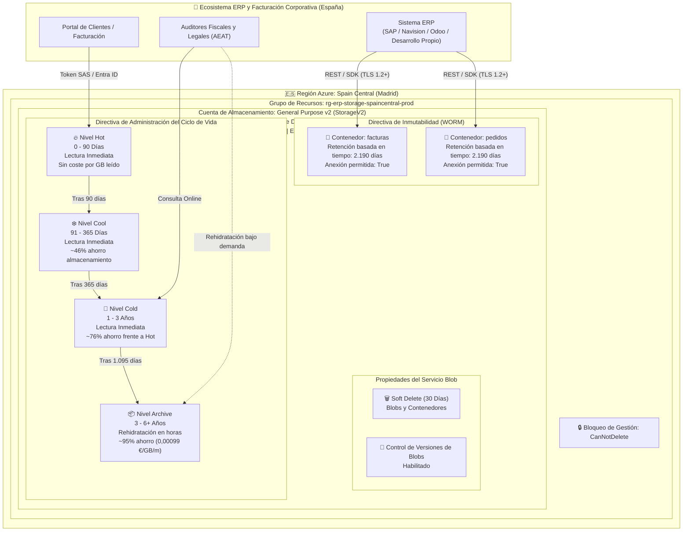

# Referencia de Arquitectura: Azure Blob Storage WORM y Ciclo de Vida Optimizado para ERP en España

---

### 🧭 Navegación de la Documentación
| 🏠 [Inicio / README](../README.md) | 🏛️ **Arquitectura** | ⚖️ [Marco Legal](LEGAL_COMPLIANCE_SPAIN.md) | 💰 [Optimización de Costes](COST_OPTIMIZATION.md) | 🔒 [Guía WORM Lock](WORM_POLICY_LOCK_GUIDE.md) | 🖱️ [Manual Portal](AZURE_PORTAL_CLICKOPS_GUIDE.md) | 📊 [Auditoría & KQL](AUDITING_AND_MONITORING.md) | 🔌 [Integración ERP](ERP_INTEGRATION_AND_REHYDRATION.md) | 🚀 [Guía CI/CD](CICD_AUTOMATION_GUIDE.md) |
| :---: | :---: | :---: | :---: | :---: | :---: | :---: | :---: | :---: |

---

Este documento describe el anteproyecto de arquitectura para el almacenamiento y archivo legal inmutable de facturas y pedidos de ERP (hasta 1 TB y escalable) en **Azure Blob Storage** en la región **Spain Central (Madrid)**.

> [!NOTE]
> **Aviso de Referencia Arquitectónica Generada por IA**
> 
> Este documento de arquitectura y sus módulos de IaC correspondientes han sido generados mediante **Gemini 3.8 Flash**.
> Aunque todo el código y las plantillas han sido validados mediante pipelines de CI (Terraform, Bicep y analizadores sintácticos), **aún no han sido desplegados ni sometidos a pruebas de estrés en un entorno de producción real**.
> 
> **Propósito**: Actúa como **anteproyecto de arquitectura de referencia, modelo formativo y marco de decisión técnica (FinOps)** para el almacenamiento normativo de ERPs en España. Los equipos deben validar las configuraciones en un entorno de pruebas (*sandbox*) antes de aplicar bloqueos permanentes WORM en producción.

---

## 📑 Tabla de Contenidos
1. [Resumen Ejecutivo y Propuesta de Valor](#resumen-ejecutivo-y-propuesta-de-valor)
2. [Diagrama de Arquitectura](#diagrama-de-arquitectura)
3. [Análisis Detallado de Componentes](#análisis-detallado-de-componentes)
   * 3.1. [Base de la Cuenta de Almacenamiento](#1-base-de-la-cuenta-de-almacenamiento)
   * 3.2. [Progresión del Ciclo de Vida (Tiering)](#2-progresión-del-ciclo-de-vida-tiering)
   * 3.3. [Directiva de Inmutabilidad WORM](#3-directiva-de-inmutabilidad-worm-cumplimiento-y-antifraude)
   * 3.4. [Seguridad Zero Trust y Defensa Antiransomware](#4-seguridad-zero-trust-y-defensa-antiransomware)
4. [Las 3 Soluciones Arquitectónicas para ERP en España](#4-las-3-soluciones-arquitectónicas-para-erp-en-españa-comparativa-exhaustiva-e-implementación)
   * 4.1. [Arquitectura 1: Mínimo Coste TCO con Archive WORM (Standard_LRS)](#41-arquitectura-1-mínimo-coste-tco-con-archive-worm-standard_lrs)
   * 4.2. [Arquitectura 2: Máxima Resiliencia Multi-Zona con Cold WORM (Standard_ZRS)](#42-arquitectura-2-máxima-resiliencia-multi-zona-con-cold-worm-standard_zrs)
   * 4.3. [Arquitectura 3: Modelo Enterprise Desacoplado Dual (ZRS Operativo + LRS Histórico)](#43-arquitectura-3-modelo-enterprise-desacoplado-dual-zrs-operativo--lrs-histórico)
   * 4.4. [Matriz Comparativa y Criterios de Selección para el Decisor Técnico](#44-matriz-comparativa-y-criterios-de-selección-para-el-decisor-técnico)
5. [Navegación entre Módulos de Documentación](#-navegación-entre-módulos)

---

## Resumen Ejecutivo y Propuesta de Valor

| Dimensión | Enfoque Tradicional (Solo Nivel Hot) | Arquitectura Optimizada de Cumplimiento ERP | Impacto Empresarial |
| :--- | :--- | :--- | :--- |
| **Coste Mensual (1 TB)** | ~19,00 € / mes | **~4,05 € – 5,50 € / mes** | **~75% – 80% de ahorro recurrente** |
| **Residencia del Dato** | Frecuentemente Ámsterdam o Dublín | **Spain Central (`spaincentral` - Madrid)** | 100% soberanía del dato en territorio español |
| **Latencia de Red** | 25 – 45 ms desde la península ibérica | **< 10 ms (latencia ultrabaja)** | Experiencia de usuario ágil en el ERP |
| **Alta Disponibilidad** | LRS (un único centro de datos) | **ZRS (3 Zonas de Disponibilidad en Madrid)** | Resiliencia ante la caída de un datacenter entero |
| **Cumplimiento Legal** | Almacenamiento mutable y vulnerable | **Directiva WORM inmutable (2.190 días / 6 años)** | Cumple con Art. 30 Cód. Comercio y VeriFactu |
| **Protección Antiransomware** | Vulnerable al borrado accidental/malicioso | **Bloqueo CanNotDelete + Soft Delete de 30 días** | Blindaje contra borrados accidentales o ataques |

---

## Diagrama de Arquitectura



---

## Análisis Detallado de Componentes

### 1. Base de la Cuenta de Almacenamiento
* **Tipo de Cuenta**: `StorageV2` (General Purpose v2). Obligatorio para disponer de los niveles de acceso (Hot, Cool, Cold, Archive) y directivas de inmutabilidad WORM a nivel de contenedor.
* **Redundancia**: `Standard_ZRS` (*Zone-Redundant Storage*) o `Standard_LRS` (*Locally-Redundant Storage*).
  * **ZRS**: Los datos se escriben sincrónicamente en tres zonas de disponibilidad físicamente separadas en la Comunidad de Madrid. Protege contra fallos en instalaciones completas (suministro eléctrico, refrigeración o red) sin incurrir en costes de salida interregional.
  * **LRS**: Réplica triple local en un único centro de datos.

> [!IMPORTANT]
> **Compatibilidad Crítica entre Nivel Archive, Redundancia ZRS y WORM**:
> En Azure Blob Storage, **el nivel Archive NO está soportado en cuentas con redundancia ZRS, GZRS ni RA-GZRS**. El nivel Archive solo está disponible para cuentas configuradas con **LRS, GRS o RA-GRS**.
> 
> * **Arquitectura 1: Coste Mínimo con Archive WORM (`Standard_LRS`)**: Dispone del ciclo completo de 4 niveles (**Hot $\rightarrow$ Cool $\rightarrow$ Cold $\rightarrow$ Archive**) con WORM legal de 2.190 días a **~4,37 €/mes por TB**.
> * **Arquitectura 2: Máxima Resiliencia de 3 Zonas con WORM (`Standard_ZRS`)**: Dispone de 3 niveles online (**Hot $\rightarrow$ Cool $\rightarrow$ Cold**) con WORM legal distribuido en las 3 zonas de Madrid a **~6,50 – 7,70 €/mes por TB**. En esta opción, las facturas se conservan en el nivel **Cold** (no debe configurarse `tierToArchive`, ya que Azure rechazaría la regla).
> * **Arquitectura 3: Modelo Desacoplado Dual (Enterprise)**: Cuenta operativa en `Standard_ZRS` (Hot + Cool para los años 0-3) y cuenta de archivo histórico en `Standard_LRS` (Archive + WORM para los años 3-6).

* **Región**: `spaincentral` (Madrid, España).
  * Garantiza que los datos fiscales, contables y personales jamás abandonen la jurisdicción española.
  * Idóneo para auditorías de la Agencia Tributaria (AEAT), el Código de Comercio y la Agencia Española de Protección de Datos (AEPD / RGPD).

### 2. Progresión del Ciclo de Vida (*Tiering*)

El motor de administración del ciclo de vida evalúa periódicamente las reglas sobre los metadatos de los blobs:

```text
Día 0                                    Día 90                Día 365               Día 1.095             Día 2.190+
  |-----------------------------------------|---------------------|---------------------|----------------------|
                   HOT                               COOL                  COLD                 ARCHIVE
            Facturas Activas                   Cierres Trimestrales      Años 2 y 3            Custodia Legal
       Lectura libre / coste base             ~46% de descuento     ~76% de descuento     ~95% descuento (0,001€)
```

1. **Nivel Hot (Días 0 a 90)**:
   * **Caso de uso**: Facturación del trimestre en curso, descargas de clientes en portales, reclamaciones de cobro y conciliación contable diaria.
   * **Características**: Rendimiento máximo, cero suplementos por lectura o recuperación de datos.
2. **Nivel Cool (Días 91 a 365)**:
   * **Caso de uso**: Liquidaciones trimestrales de IVA (Modelo 303), cierres anuales del Impuesto de Sociedades (Modelo 200) y resúmenes anuales (Modelo 390).
   * **Características**: Acceso online en milisegundos, reducción de aproximadamente el 46% en el precio de almacenamiento por GB.
3. **Nivel Cold (Días 366 a 1.095 / Años 1 a 3)**:
   * **Caso de uso**: Inspecciones tributarias habituales, consultas de ejercicios anteriores y comprobaciones de garantías.
   * **Características**: Acceso online inmediato con un ahorro de ~76% respecto al nivel Hot.
4. **Nivel Archive (Días 1.096 a 2.190+ / Años 3 a 6+)**:
   * **Caso de uso**: Custodia legal estricta conforme al Art. 30 del Código de Comercio.
   * **Características**: Coste marginal mínimo (~0,00099 €/GB/mes). Almacenamiento offline que requiere rehidratación (Estándar: 3 a 15 horas; Alta prioridad: < 1 hora) previa a la lectura.

### 3. Directiva de Inmutabilidad WORM (Cumplimiento y Antifraude)

* **Mecanismo**: Directiva de retención basada en tiempo (*Time-based retention policy*).
* **Duración**: **2.190 días** (6 años naturales completos).
* **Ámbito**: Nivel de contenedor (`facturas` y `pedidos`).
* **Soporte de Anexión**: `allowProtectedAppendWrites = true`.
  * Permite añadir nuevos bloques o trazas de auditoría encadenadas a blobs de tipo append sin permitir la alteración ni el truncado de los bloques históricos ya confirmados (requisito VeriFactu).
* **Estados Operativos**:
  * **Desbloqueado / Unlocked (Fase de Pruebas)**: La directiva está activa y protege los blobs, pero el administrador puede eliminarla o acortarla si detecta errores durante las pruebas iniciales.
  * **Bloqueado / Locked (Modo Legal Permanente)**: Una vez ejecutada la acción de bloqueo confirmada, la directiva **NO PUEDE SER ELIMINADA NI ACORTADA**, ni por los Propietarios de la suscripción, ni por Administradores Globales, ni por el soporte técnico de Microsoft Azure.

### 4. Seguridad Zero Trust y Defensa Antiransomware

1. **Gestión de Identidades y Accesos (IAM)**:
   * Acceso forzado mediante **Microsoft Entra ID RBAC** (`Storage Blob Data Contributor` / `Storage Blob Data Reader`).
   * Posibilidad de deshabilitar el acceso mediante claves compartidas estáticas (`shared_access_key_enabled = false`) para mitigar la fuga de credenciales.
2. **Seguridad de Red**:
   * Acceso público anónimo bloqueado (`allow_blob_public_access = false`).
   * Cortafuegos de almacenamiento con listas blancas de IPs públicas de los servidores del ERP o endpoints privados (*Private Endpoints*).
   * Cifrado en tránsito exigido con TLS 1.2 como mínimo (`min_tls_version = "TLS1_2"`).
   * Obligatoriedad estricta de tráfico HTTPS (`https_traffic_only_enabled = true`).
3. **Protección contra Pérdida de Datos**:
   * **Soft Delete**: Configurado a 30 días tanto para blobs como para contenedores, permitiendo revertir borrados accidentales.
   * **Control de Versiones de Blobs**: Mantiene automáticamente el historial inalterable de versiones.
   * **Bloqueo de Gestión de Azure**: Bloqueo `CanNotDelete` aplicado a nivel de cuenta para evitar que herramientas automatizadas o cuentas comprometidas eliminen la cuenta de almacenamiento.

---

## 4. Las 3 Soluciones Arquitectónicas para ERP en España: Comparativa Exhaustiva e Implementación

Debido a la limitación técnica de Microsoft Azure donde **el nivel Archive no está soportado en cuentas con redundancia ZRS, GZRS ni RA-GZRS**, existen tres patrones de arquitectura plenamente válidos para sistemas ERP sujetos a la legislación española (Código de Comercio Art. 30, Ley 11/2021 Antifraude y RD 1007/2023 VeriFactu):

```mermaid
flowchart TD
    subgraph Sol1["🏛️ Arquitectura 1: Mínimo Coste TCO (Standard_LRS)"]
        direction TB
        A1["Cuenta Única: Standard_LRS (1 Datacenter Madrid)"]
        A1_Life["Ciclo 4 Fases: Hot (90d) → Cool (365d) → Cold (3a) → Archive (6a)"]
        A1_WORM["WORM 2.190 días (6 años) Activo en las 4 Fases"]
        A1_Cost["Coste: ~4,37 €/mes por TB | Ahorro: 76,8%"]
        A1_SLA["SLA Lectura: 99,9% | Rehidratación: 3 a 15h (~3,33 €/100GB)"]
    end

    subgraph Sol2["🛡️ Arquitectura 2: Máxima Resiliencia 3 Zonas (Standard_ZRS)"]
        direction TB
        B1["Cuenta Única: Standard_ZRS (3 Zonas de Disponibilidad Madrid)"]
        B1_Life["Ciclo 3 Fases Online: Hot (90d) → Cool (365d) → Cold (1 a 6 años)"]
        B1_WORM["WORM 2.190 días (6 años) Distribuido en las 3 Zonas"]
        B1_Cost["Coste: ~7,70 €/mes por TB | Ahorro: 67,1%"]
        B1_SLA["SLA Lectura: 99,99% | Online Inmediato (<10 ms) | 0 € Rehidratación"]
    end

    subgraph Sol3["⚡ Arquitectura 3: Modelo Enterprise Desacoplado Dual"]
        direction TB
        C1["Cuenta Primaria Operativa: Standard_ZRS (Madrid 3 Zonas)"]
        C1_Life["Años 0 a 3: Hot y Cool (Alta Disponibilidad ERP)"]
        C2["Cuenta Histórica de Archivo: Standard_LRS (Madrid)"]
        C2_Life["Años 3 a 6: Archive + WORM Legal (0,00099 €/GB/m)"]
        C_Pipeline["Pipeline Automático de Volcado (Event Grid / Data Factory / azcopy)"]
        C1 -->|A los 3 años| C_Pipeline --> C2
        C_Cost["Coste Ponderado: ~5,30 €/mes por TB | Ahorro: 73,5%"]
    end
```



---

### 4.1. Arquitectura 1: Mínimo Coste TCO con Archive WORM (`Standard_LRS`)

#### Concepto y Justificación
Es la solución de referencia para organizaciones cuyo mandato estratégico primordial es la **eficiencia financiera (FinOps)** y el mínimo coste operativo, y cuyos procedimientos de auditoría tributaria admiten ventanas de respuesta de varias horas para facturas de ejercicios fiscales antiguos.

#### Características Técnicas
* **Topología**: Cuenta única `StorageV2` en la región `spaincentral` (Madrid) con redundancia local `Standard_LRS` (3 copias síncronas en el mismo centro de datos).
* **Ciclo de Vida (4 Fases Automatizadas)**:
  1. **Hot (Días 0 – 90)**: Facturas y pedidos en curso. Rendimiento óptimo, consultas directas del ERP.
  2. **Cool (Días 91 – 365)**: Facturas del año fiscal cerrado o en liquidación. ~46% de ahorro en almacenamiento.
  3. **Cold (Días 366 – 1.095 / Años 1 a 3)**: Facturas dentro del plazo de inspección fiscal ordinario. ~76% de ahorro.
  4. **Archive (Días 1.096 – 2.190+ / Años 3 a 6+)**: Custodia legal mercantil obligatoria según el Art. 30 del Código de Comercio. Almacenamiento en cintas/medios *offline* a ~0,00099 €/GB/mes (~95% de ahorro).
* **Inmutabilidad WORM**: Directiva de retención de 2.190 días bloqueada permanentemente. La directiva sigue protegiendo los blobs en el nivel *Archive* (Azure prohíbe el borrado de blobs inmutables archivados).
* **Durabilidad y SLA**: Durabilidad del 99,999999999% anual (11 nueves). SLA de disponibilidad de lectura en Hot/Cool del 99,9%.
* **Coste Mensual Estable (1 TB)**: **~4,37 € / mes** (~52,44 € al año; ~314,64 € en 6 años). Representa un ahorro del 76,8% frente a mantener todo en Hot LRS.
* **Procedimiento Operativo ante Inspección de la AEAT**:
  * Si la Agencia Tributaria notifica una inspección sobre el ejercicio de hace 4 años, se solicita la rehidratación del lote de facturas (ej. 100 GB / ~20.000 facturas) a nivel *Cool*.
  * En **Prioridad Estándar**, el lote está disponible en 3 a 15 horas con un coste total de **~3,33 €**.
  * En **Alta Prioridad**, el lote está disponible en menos de 1 hora con un coste total de **~5,77 €** (50 GB).
* **Configuración en IaC**:
  * **Terraform**: `account_replication_type = "LRS"`, `tier_to_archive_days = 1095`.
  * **Bicep**: `skuName = 'Standard_LRS'` (activa automáticamente `enableArchiveTier = true`).

---

### 4.2. Arquitectura 2: Máxima Resiliencia Multi-Zona con Cold WORM (`Standard_ZRS`)

#### Concepto y Justificación
Diseñada para empresas corporativas, entidades reguladas y multinacionales que exigen **máxima resiliencia física frente a desastres** (capacidad de tolerar la caída completa de un centro de datos en la Comunidad de Madrid) y **acceso inmediato en milisegundos a cualquier factura histórica**, eliminando por completo los tiempos de espera y las tasas de rehidratación.

#### Características Técnicas
* **Topología**: Cuenta única `StorageV2` en la región `spaincentral` (Madrid) con redundancia de zona `Standard_ZRS` (datos replicados sincrónicamente en 3 zonas de disponibilidad físicas independientes separadas por kilómetros).
* **Ciclo de Vida (3 Fases Online)**:
  1. **Hot (Días 0 – 90)**: Facturas recientes y operaciones activas de facturación.
  2. **Cool (Días 91 – 365)**: Facturas del año contable.
  3. **Cold (Días 366 – 2.190 / Años 1 a 6)**: Custodia fiscal y mercantil durante el resto de la vida legal. **Se omite el nivel Archive**, manteniendo los datos en el nivel *Cold* en línea distribuido en las 3 zonas.
* **Inmutabilidad WORM**: Directiva de retención de 2.190 días bloqueada en las 3 zonas de disponibilidad simultáneamente.
* **Durabilidad y SLA**: Durabilidad del 99,9999999999% anual (12 nueves). SLA de disponibilidad de lectura del 99,99%.
* **Coste Mensual Estable (1 TB)**: **~7,70 € / mes** (~92,40 € al año; ~554,40 € en 6 años). Proporciona un ahorro del 67,1% frente a los 23,40 €/mes de Hot ZRS.
* **Ventajas Operativas Críticas**:
  1. **Acceso Online Inmediato (< 10 ms)**: Cualquier auditoría de la AEAT, peritaje judicial o comprobación de garantía se responde al instante en milisegundos.
  2. **Cero Costes de Rehidratación**: El coste de recuperación ante auditorías es estrictamente **0,00 €**.
  3. **Cero Complejidad**: No requiere flujos asíncronos en el ERP para comprobar si un blob archivado ya se ha descongelado.
* **Configuración en IaC**:
  * **Terraform**: `account_replication_type = "ZRS"` (la plantilla detecta el SKU ZRS y omite `tier_to_archive` para evitar el error `InvalidTierForRedundancyType`).
  * **Bicep**: `skuName = 'Standard_ZRS'` (establece automáticamente `enableArchiveTier = false`).

---

### 4.3. Arquitectura 3: Modelo Enterprise Desacoplado Dual (*Dual-Account Tiering*)

#### Concepto y Justificación
Resuelve el dilema de ingeniería para grandes corporaciones que buscan simultáneamente:
1. **Resiliencia multi-zona (ZRS)** para los ejercicios fiscales vivos (años 0 a 3) donde el volumen de consultas y modificaciones es frecuente.
2. **Coste ultra-reducido de Archive (~0,00099 €/GB/mes)** para el repositorio legal pasivo de facturas históricas (años 3 a 6).

#### Topología y Componentes
* **Cuenta Primaria Operativa (`Standard_ZRS`)**:
  * Nombre representativo: `sterpprodmadridzrs`.
  * Redundancia: `Standard_ZRS` (3 AZs en Spain Central).
  * Niveles activos: *Hot* (días 0-90) $\rightarrow$ *Cool* (días 91-1095).
  * Directiva WORM: Retención de 1.095 días (3 años) bloqueada.
* **Cuenta Secundaria de Archivo Histórico (`Standard_LRS`)**:
  * Nombre representativo: `sterpprodmadridarchive`.
  * Redundancia: `Standard_LRS` (Spain Central).
  * Nivel de destino: *Archive* directo.
  * Directiva WORM: Retención de 1.095 días (años 3 a 6) bloqueada.
* **Mecanismo de Desacoplamiento y Sincronización**:
  * Una tarea programada o un desencadenador de **Azure Event Grid** con **Azure Logic Apps** o **Azure Data Factory** ejecuta una sincronización automatizada al cierre de cada ejercicio contable.
  * Copia segura con autenticación basada en identidades administradas (*Managed Identity*) y `azcopy`:
    ```bash
    azcopy copy \
      "https://sterpprodmadridzrs.blob.core.windows.net/facturas/*" \
      "https://sterpprodmadridarchive.blob.core.windows.net/facturas-historico/*" \
      --block-blob-tier=Archive \
      --trusted-microsoft-suffixes=blob.core.windows.net
    ```
  * Tras verificar la integridad del blob copiado en la cuenta de archivo y su bloqueo WORM legal, el blob en la cuenta primaria expira de forma segura tras completar su retención de 3 años.
* **Coste Ponderado Mensual (1 TB)**: **~5,30 € / mes** (~63,60 € al año; ~381,60 € en 6 años). Ahorro neto del 73,5%.

---

### 4.4. Matriz Comparativa y Criterios de Selección para el Decisor Técnico

| Criterio de Decisión / Métrica | Opción 1: Mínimo TCO (LRS 4 Niveles) | Opción 2: Máxima Resiliencia (ZRS 3 Niveles) | Opción 3: Modelo Enterprise Dual |
| :--- | :---: | :---: | :---: |
| **SKU de Redundancia Azure** | `Standard_LRS` | `Standard_ZRS` | `Standard_ZRS` + `Standard_LRS` |
| **Zonas de Disponibilidad en Madrid** | 1 centro de datos (3 copias) | **3 Zonas Físicas Independientes** | 3 Zonas (años 0-3) / 1 Zona (años 3-6) |
| **Durabilidad Anual del Dato** | 99,999999999% (11 nueves) | **99,9999999999% (12 nueves)** | 12 nueves (vivos) / 11 nueves (archivo) |
| **SLA de Disponibilidad de Lectura** | 99,9% | **99,99%** | 99,99% (vivos) / 99,9% (archivo) |
| **Niveles de Almacenamiento Usados** | Hot $\rightarrow$ Cool $\rightarrow$ Cold $\rightarrow$ **Archive** | Hot $\rightarrow$ Cool $\rightarrow$ **Cold (1-6a)** | Hot/Cool (ZRS) + **Archive (LRS)** |
| **Factura Mensual (1 TB en Régimen)**| **~4,37 € / mes** | **~7,70 € / mes** | **~5,30 € / mes** |
| **Factura Anual (1 TB)** | **~52,44 € / año** | **~92,40 € / año** | **~63,60 € / año** |
| **TCO Acumulado a 6 Años (1 TB)** | **~314,64 €** | **~554,40 €** | **~381,60 €** |
| **Ahorro vs. Enfoque Tradicional Todo-Hot**| **76,8% de reducción** | **67,1% de reducción** | **73,5% de reducción** |
| **Tiempo de Acceso a Facturas de >3 Años**| 3 a 15 horas (Rehidratación) | **Inmediato (< 10 ms)** | 3 a 15 horas (Rehidratación) |
| **Coste de Recuperación ante Inspección AEAT**| ~3,33 € por 100 GB | **0,00 € (Sin costes de rehidratación)** | ~3,33 € por 100 GB |
| **Complejidad de Despliegue y Operación**| 🟢 Mínima (1 cuenta de storage) | 🟢 Mínima (1 cuenta de storage) | 🟡 Media (2 cuentas + pipeline de copia) |
| **Idoneidad Estratégica** | PYMEs, medianas empresas y proyectos donde optimizar costes es la prioridad #1. | Grandes empresas, banca, seguros, y sistemas ERP con SLA estricto de auditoría inmediata. | Corporaciones multinacionales con gran volumen (>10 TB) que requieren ZRS y Archive. |

> [!TIP]
> **Recomendación para la Mayoría de Entornos ERP**:
> * **Para Entornos de Producción Estándar**: Se recomienda la **Opción 2 (`Standard_ZRS`)**, ya que por una diferencia de apenas **~3,33 €/mes por TB** garantiza tolerancia a desastres en Madrid y elimina cualquier coste o tiempo de espera ante auditorías tributarias.
> * **Para Archivo Histórico Masivo (> 5 TB)**: Se recomienda la **Opción 1 (`Standard_LRS`)**, maximizando el ahorro FinOps con el nivel Archive.

---

## 🧭 Navegación entre Módulos

* 🏠 **Inicio**: [README Principal](../README.md)
* ➡️ **Siguiente**: [Marco Legal y Cumplimiento Normativo (España y UE)](LEGAL_COMPLIANCE_SPAIN.md)
* 📑 **Índice Completo de Documentación**:
  1. 🏛️ **Arquitectura Técnica** (Documento actual)
  2. ⚖️ [Marco Legal y Cumplimiento Normativo (España y UE)](LEGAL_COMPLIANCE_SPAIN.md)
  3. 💰 [Análisis Financiero y Optimización de Costes (TCO)](COST_OPTIMIZATION.md)
  4. 🔒 [Guía Operativa del Bloqueo WORM (Policy Lock)](WORM_POLICY_LOCK_GUIDE.md)
  5. 🖱️ [Manual Paso a Paso en Azure Portal (ClickOps)](AZURE_PORTAL_CLICKOPS_GUIDE.md)
  6. 📊 [Auditoría, Monitorización y Consultas KQL](AUDITING_AND_MONITORING.md)
  7. 🔌 [Guía de Integración ERP y Rehidratación](ERP_INTEGRATION_AND_REHYDRATION.md)
  8. 🚀 [Automatización CI/CD Multiplataforma](CICD_AUTOMATION_GUIDE.md)

