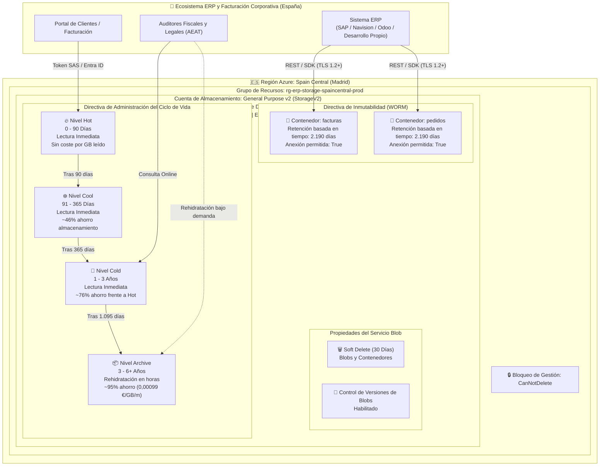

# Referencia de Arquitectura: Azure Blob Storage WORM y Ciclo de Vida Optimizado para ERP en España

---

### 🧭 Navegación de la Documentación
| 🏠 [Inicio / README](../README.md) | 🏛️ **Arquitectura** | ⚖️ [Marco Legal](LEGAL_COMPLIANCE_SPAIN.md) | 💰 [Optimización de Costes](COST_OPTIMIZATION.md) | 🔒 [Guía WORM Lock](WORM_POLICY_LOCK_GUIDE.md) | 🖱️ [Manual Portal](AZURE_PORTAL_CLICKOPS_GUIDE.md) | 📊 [Auditoría & KQL](AUDITING_AND_MONITORING.md) | 🔌 [Integración ERP](ERP_INTEGRATION_AND_REHYDRATION.md) | 🚀 [Guía CI/CD](CICD_AUTOMATION_GUIDE.md) |
| :---: | :---: | :---: | :---: | :---: | :---: | :---: | :---: | :---: |

---

Este documento describe el anteproyecto de arquitectura para el almacenamiento y archivo legal inmutable de facturas y pedidos de ERP (hasta 1 TB y escalable) en **Azure Blob Storage** en la región **Spain Central (Madrid)**.

> [!NOTE]
> **Aviso de Referencia Arquitectónica Generada por IA**
> 
> Este documento de arquitectura y sus módulos de IaC correspondientes han sido generados mediante **Gemini 3.8 Flash**.
> Aunque todo el código y las plantillas han sido validados mediante pipelines de CI (Terraform, Bicep y analizadores sintácticos), **aún no han sido desplegados ni sometidos a pruebas de estrés en un entorno de producción real**.
> 
> **Propósito**: Actúa como **anteproyecto de arquitectura de referencia, modelo formativo y marco de decisión técnica (FinOps)** para el almacenamiento normativo de ERPs en España. Los equipos deben validar las configuraciones en un entorno de pruebas (*sandbox*) antes de aplicar bloqueos permanentes WORM en producción.

---

## 📑 Tabla de Contenidos
1. [Resumen Ejecutivo y Propuesta de Valor](#resumen-ejecutivo-y-propuesta-de-valor)
2. [Diagrama de Arquitectura](#diagrama-de-arquitectura)
3. [Análisis Detallado de Componentes](#análisis-detallado-de-componentes)
   * 3.1. [Base de la Cuenta de Almacenamiento](#1-base-de-la-cuenta-de-almacenamiento)
   * 3.2. [Progresión del Ciclo de Vida (Tiering)](#2-progresión-del-ciclo-de-vida-tiering)
   * 3.3. [Directiva de Inmutabilidad WORM](#3-directiva-de-inmutabilidad-worm-cumplimiento-y-antifraude)
   * 3.4. [Seguridad Zero Trust y Defensa Antiransomware](#4-seguridad-zero-trust-y-defensa-antiransomware)
4. [Navegación entre Módulos de Documentación](#-navegación-entre-módulos)

---

## Resumen Ejecutivo y Propuesta de Valor

| Dimensión | Enfoque Tradicional (Solo Nivel Hot) | Arquitectura Optimizada de Cumplimiento ERP | Impacto Empresarial |
| :--- | :--- | :--- | :--- |
| **Coste Mensual (1 TB)** | ~19,00 € / mes | **~4,05 € – 5,50 € / mes** | **~75% – 80% de ahorro recurrente** |
| **Residencia del Dato** | Frecuentemente Ámsterdam o Dublín | **Spain Central (`spaincentral` - Madrid)** | 100% soberanía del dato en territorio español |
| **Latencia de Red** | 25 – 45 ms desde la península ibérica | **< 10 ms (latencia ultrabaja)** | Experiencia de usuario ágil en el ERP |
| **Alta Disponibilidad** | LRS (un único centro de datos) | **ZRS (3 Zonas de Disponibilidad en Madrid)** | Resiliencia ante la caída de un datacenter entero |
| **Cumplimiento Legal** | Almacenamiento mutable y vulnerable | **Directiva WORM inmutable (2.190 días / 6 años)** | Cumple con Art. 30 Cód. Comercio y VeriFactu |
| **Protección Antiransomware** | Vulnerable al borrado accidental/malicioso | **Bloqueo CanNotDelete + Soft Delete de 30 días** | Blindaje contra borrados accidentales o ataques |

---

## Diagrama de Arquitectura



---

## Análisis Detallado de Componentes

### 1. Base de la Cuenta de Almacenamiento
* **Tipo de Cuenta**: `StorageV2` (General Purpose v2). Obligatorio para disponer de los 4 niveles de acceso (Hot, Cool, Cold, Archive) y directivas de inmutabilidad WORM a nivel de contenedor.
* **Redundancia**: `Standard_ZRS` (*Zone-Redundant Storage*).
  * Los datos se escriben sincrónicamente en tres zonas de disponibilidad físicamente separadas en la Comunidad de Madrid.
  * Protege contra fallos en instalaciones completas (suministro eléctrico, refrigeración o red) sin incurrir en costes de salida interregional.
  * Puede parametrizarse a `Standard_LRS` en entornos de no producción para abaratar costes.
* **Región**: `spaincentral` (Madrid, España).
  * Garantiza que los datos fiscales, contables y personales jamás abandonen la jurisdicción española.
  * Idóneo para auditorías de la Agencia Tributaria (AEAT), el Código de Comercio y la Agencia Española de Protección de Datos (AEPD / RGPD).

### 2. Progresión del Ciclo de Vida (*Tiering*)

El motor de administración del ciclo de vida evalúa periódicamente las reglas sobre los metadatos de los blobs:

```text
Día 0                                    Día 90                Día 365               Día 1.095             Día 2.190+
  |-----------------------------------------|---------------------|---------------------|----------------------|
                   HOT                               COOL                  COLD                 ARCHIVE
            Facturas Activas                   Cierres Trimestrales      Años 2 y 3            Custodia Legal
       Lectura libre / coste base             ~46% de descuento     ~76% de descuento     ~95% descuento (0,001€)
```

1. **Nivel Hot (Días 0 a 90)**:
   * **Caso de uso**: Facturación del trimestre en curso, descargas de clientes en portales, reclamaciones de cobro y conciliación contable diaria.
   * **Características**: Rendimiento máximo, cero suplementos por lectura o recuperación de datos.
2. **Nivel Cool (Días 91 a 365)**:
   * **Caso de uso**: Liquidaciones trimestrales de IVA (Modelo 303), cierres anuales del Impuesto de Sociedades (Modelo 200) y resúmenes anuales (Modelo 390).
   * **Características**: Acceso online en milisegundos, reducción de aproximadamente el 46% en el precio de almacenamiento por GB.
3. **Nivel Cold (Días 366 a 1.095 / Años 1 a 3)**:
   * **Caso de uso**: Inspecciones tributarias habituales, consultas de ejercicios anteriores y comprobaciones de garantías.
   * **Características**: Acceso online inmediato con un ahorro de ~76% respecto al nivel Hot.
4. **Nivel Archive (Días 1.096 a 2.190+ / Años 3 a 6+)**:
   * **Caso de uso**: Custodia legal estricta conforme al Art. 30 del Código de Comercio.
   * **Características**: Coste marginal mínimo (~0,00099 €/GB/mes). Almacenamiento offline que requiere rehidratación (Estándar: 3 a 15 horas; Alta prioridad: < 1 hora) previa a la lectura.

### 3. Directiva de Inmutabilidad WORM (Cumplimiento y Antifraude)

* **Mecanismo**: Directiva de retención basada en tiempo (*Time-based retention policy*).
* **Duración**: **2.190 días** (6 años naturales completos).
* **Ámbito**: Nivel de contenedor (`facturas` y `pedidos`).
* **Soporte de Anexión**: `allowProtectedAppendWrites = true`.
  * Permite añadir nuevos bloques o trazas de auditoría encadenadas a blobs de tipo append sin permitir la alteración ni el truncado de los bloques históricos ya confirmados (requisito VeriFactu).
* **Estados Operativos**:
  * **Desbloqueado / Unlocked (Fase de Pruebas)**: La directiva está activa y protege los blobs, pero el administrador puede eliminarla o acortarla si detecta errores durante las pruebas iniciales.
  * **Bloqueado / Locked (Modo Legal Permanente)**: Una vez ejecutada la acción de bloqueo confirmada, la directiva **NO PUEDE SER ELIMINADA NI ACORTADA**, ni por los Propietarios de la suscripción, ni por Administradores Globales, ni por el soporte técnico de Microsoft Azure.

### 4. Seguridad Zero Trust y Defensa Antiransomware

1. **Gestión de Identidades y Accesos (IAM)**:
   * Acceso forzado mediante **Microsoft Entra ID RBAC** (`Storage Blob Data Contributor` / `Storage Blob Data Reader`).
   * Posibilidad de deshabilitar el acceso mediante claves compartidas estáticas (`shared_access_key_enabled = false`) para mitigar la fuga de credenciales.
2. **Seguridad de Red**:
   * Acceso público anónimo bloqueado (`allow_blob_public_access = false`).
   * Cortafuegos de almacenamiento con listas blancas de IPs públicas de los servidores del ERP o endpoints privados (*Private Endpoints*).
   * Cifrado en tránsito exigido con TLS 1.2 como mínimo (`min_tls_version = "TLS1_2"`).
   * Obligatoriedad estricta de tráfico HTTPS (`https_traffic_only_enabled = true`).
3. **Protección contra Pérdida de Datos**:
   * **Soft Delete**: Configurado a 30 días tanto para blobs como para contenedores, permitiendo revertir borrados accidentales.
   * **Control de Versiones de Blobs**: Mantiene automáticamente el historial inalterable de versiones.
   * **Bloqueo de Gestión de Azure**: Bloqueo `CanNotDelete` aplicado a nivel de cuenta para evitar que herramientas automatizadas o cuentas comprometidas eliminen la cuenta de almacenamiento.

---

## 🧭 Navegación entre Módulos

* 🏠 **Inicio**: [README Principal](../README.md)
* ➡️ **Siguiente**: [Marco Legal y Cumplimiento Normativo (España y UE)](LEGAL_COMPLIANCE_SPAIN.md)
* 📑 **Índice Completo de Documentación**:
  1. 🏛️ **Arquitectura Técnica** (Documento actual)
  2. ⚖️ [Marco Legal y Cumplimiento Normativo (España y UE)](LEGAL_COMPLIANCE_SPAIN.md)
  3. 💰 [Análisis Financiero y Optimización de Costes (TCO)](COST_OPTIMIZATION.md)
  4. 🔒 [Guía Operativa del Bloqueo WORM (Policy Lock)](WORM_POLICY_LOCK_GUIDE.md)
  5. 🖱️ [Manual Paso a Paso en Azure Portal (ClickOps)](AZURE_PORTAL_CLICKOPS_GUIDE.md)
  6. 📊 [Auditoría, Monitorización y Consultas KQL](AUDITING_AND_MONITORING.md)
  7. 🔌 [Guía de Integración ERP y Rehidratación](ERP_INTEGRATION_AND_REHYDRATION.md)
  8. 🚀 [Automatización CI/CD Multiplataforma](CICD_AUTOMATION_GUIDE.md)

