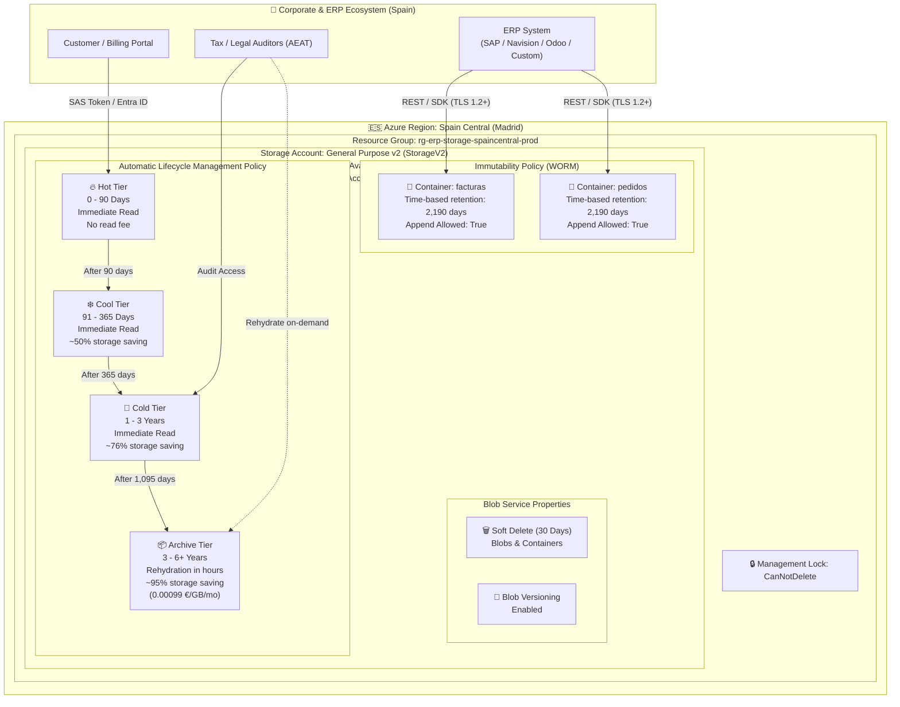

# Architectural Reference: Azure Blob Storage WORM & Cost-Optimized Tiering for Spanish ERP

This document outlines the architectural blueprint for storing and legally archiving ERP invoices and orders (up to 1 TB and scaling) in **Azure Blob Storage** within the **Spain Central (Madrid)** region.

> [!NOTE]
> **AI Architecture Reference & Disclaimer**
> 
> This architecture document and corresponding IaC modules were generated with **Gemini 3.8 Flash**.
> While all code and templates have been validated through CI pipelines (Terraform, Bicep, shell/PowerShell parsers), they **have not yet been deployed or stress-tested in a live production environment**.
> 
> **Purpose**: This blueprint serves as an **architectural reference, educational model, and decision framework** for enterprise ERP storage compliance in Spain. Teams must validate all configurations in a sandbox environment before applying permanent WORM policy locks in production.

---

## Executive Summary & Value Proposition

| Dimension | Standard Approach (Hot Tier Only) | Optimized ERP Compliance Architecture | Business Impact |
| :--- | :--- | :--- | :--- |
| **Monthly Cost (1 TB)** | ~19.00 € / month | **~4.05 € – 5.50 € / month** | **~75% – 80% recurring savings** |
| **Data Residency** | Often West Europe (Amsterdam) or North Europe (Dublin) | **Spain Central (`spaincentral` - Madrid)** | 100% Spanish territory data sovereignty |
| **Network Latency** | 25 – 45 ms from Iberian peninsula | **< 10 ms ultra-low latency** | Seamless ERP user experience |
| **High Availability** | LRS (single data center) | **ZRS (3 independent Availability Zones in Madrid)** | Resilient against entire data center outage |
| **Legal Compliance** | Mutable storage, vulnerable to tampering | **WORM Immutability Policy (2,190 days / 6 years)** | Compliant with Código de Comercio Art. 30 & VeriFactu |
| **Ransomware Defense** | Vulnerable to accidental/malicious deletion | **CanNotDelete Resource Lock + 30-day Soft Delete** | Tamper-proof, zero accidental loss |

---

## Architectural Diagram



---

## Component Deep Dive

### 1. Storage Account Baseline
* **Account Type**: `StorageV2` (General Purpose v2). Required for access tiering (Hot, Cool, Cold, Archive) and WORM container immutability policies.
* **Redundancy**: `Standard_ZRS` (Zone-Redundant Storage).
  * Data is synchronously written across three physically separated Azure availability zones within Madrid.
  * Protects against single facility failures (power, cooling, networking) without requiring inter-region egress costs.
  * Can be configured as `Standard_LRS` for non-production environments to reduce cost further.
* **Region**: `spaincentral` (Madrid, Spain).
  * Guarantees that tax, accounting, and personal data never leave Spanish jurisdiction.
  * Ideal for compliance with the Spanish General Tax Law (LGT), the Commercial Code, and the Spanish Data Protection Agency (AEPD / RGPD).

### 2. Access Tier Lifecycle Automation (Tiering Progression)

The lifecycle management engine continuously runs server-side evaluations against blob metadata:

```text
Day 0                                    Day 90                Day 365               Day 1095              Day 2190+
  |-----------------------------------------|---------------------|---------------------|----------------------|
                   HOT                               COOL                  COLD                 ARCHIVE
             Active Invoices                   Quarterly/Annual          Year 2 & 3           Legal Custody
          Free read / standard cost             ~50% discount         ~76% discount        ~95% discount (0.001€)
```

1. **Hot Tier (Days 0 to 90)**:
   * **Use Case**: Current quarter billing, customer downloads, payment disputes, ongoing accounting reconciliation.
   * **Characteristics**: Full performance, zero retrieval/read surcharge.
2. **Cool Tier (Days 91 to 365)**:
   * **Use Case**: Quarterly VAT settlements (Modelo 303), annual corporate tax closes (Modelo 200/390).
   * **Characteristics**: Online sub-millisecond retrieval, ~50% reduction in storage price per GB.
3. **Cold Tier (Days 366 to 1,095 / Years 1 to 3)**:
   * **Use Case**: Financial audits, retroactive invoice queries, warranty verifications.
   * **Characteristics**: Online immediate access with ~76% storage cost reduction.
4. **Archive Tier (Days 1,096 to 2,190+ / Years 3 to 6+)**:
   * **Use Case**: Strict statutory custody under Código de Comercio (Art. 30).
   * **Characteristics**: Lowest possible cost (~0.00099 €/GB/month). Offline storage requiring rehydration (3 to 15 hours, or High Priority in under 1 hour) before reading.

### 3. WORM Immutability Policy (Compliance & Anti-Fraud)

* **Mechanism**: Time-based retention policy (`LegalHold` or `TimeBasedRetention`).
* **Duration**: **2,190 days** (6 complete calendar years).
* **Scope**: Container level (`facturas` and `pedidos`).
* **Append Support**: `allowProtectedAppendWrites = true`.
  * Allows appending new blocks or audit records to existing append blobs without altering historical contents.
* **States**:
  * **Unlocked (Test / Grace State)**: The policy is active and protects blobs, but administrators can delete or shorten the policy if needed during deployment verification.
  * **Locked (Production State)**: Once locked via the specific confirmation script or pipeline step, the policy **CANNOT BE DELETED OR SHORTENED**, even by Azure Subscription Owners, Global Admins, or Microsoft Support engineering.

### 4. Zero-Trust Security & Ransomware Defense

1. **Identity & Access Management (IAM)**:
   * Enforce **Microsoft Entra ID RBAC** (`Storage Blob Data Contributor` / `Storage Blob Data Reader`).
   * Option to disable Shared Access Keys (`shared_access_key_enabled = false`) to eradicate static secret exposure.
2. **Network Security**:
   * Default public access blocked (`allow_blob_public_access = false`).
   * Storage Firewall with allowed IP ranges or Virtual Network Service Endpoints / Private Endpoints.
   * Enforce TLS 1.2 minimum (`min_tls_version = "TLS1_2"`).
   * Enforce HTTPS only (`enable_https_traffic_only = true`).
3. **Data Loss & Ransomware Protection**:
   * **Soft Delete**: Configured for 30 days on both blobs and containers. Accidental deletions remain recoverable.
   * **Blob Versioning**: Preserves previous versions of blobs automatically.
   * **Azure Resource Lock**: `CanNotDelete` lock applied at the storage account level prevents accidental deletion of the entire account by automated tools or compromised administrator credentials.
