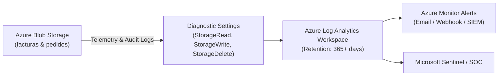

# Auditing, Monitoring & KQL Queries: Azure Storage Compliance

In regulated environments subject to the **Spanish Tax Agency (AEAT)**, the **Ley Antifraude (Ley 11/2021)**, **VeriFactu (RD 1007/2023)**, and the **RGPD**, companies must not only guarantee that data is immutable, but also provide an unalterable **audit trail of every access, modification attempt, and administrative event**.

---

## 1. Diagnostic Settings Architecture



### Telemetry Categories to Enable
1. **`StorageRead`**: Logs all reads and downloads (essential for RGPD access auditing).
2. **`StorageWrite`**: Logs all creations, uploads, and append blocks (VeriFactu proof of insertion).
3. **`StorageDelete`**: Logs all deletion attempts (captures rejected attempts blocked by WORM).
4. **`Transaction` Metrics**: Ingestion volume, latency, and request counts.

---

## 2. Enabling Diagnostic Settings via IaC / CLI

### Azure CLI
```bash
az monitor diagnostic-settings create \
  --name "diag-storage-audit" \
  --resource "/subscriptions/<SUB_ID>/resourceGroups/rg-erp-storage-prod-spaincentral/providers/Microsoft.Storage/storageAccounts/<STORAGE_ACCOUNT>/blobServices/default" \
  --workspace "/subscriptions/<SUB_ID>/resourceGroups/<RG>/providers/Microsoft.OperationalInsights/workspaces/<LOG_ANALYTICS_WORKSPACE>" \
  --logs '[{"category":"StorageRead","enabled":true},{"category":"StorageWrite","enabled":true},{"category":"StorageDelete","enabled":true}]' \
  --metrics '[{"category":"Transaction","enabled":true}]'
```

---

## 3. Ready-to-Run Kusto (KQL) Queries for Auditors

Run these queries in **Azure Monitor Log Analytics** on the `StorageBlobLogs` table:

### Query 1: Detect Rejected Deletion Attempts (WORM Violations / Tamper Audit)
Detects any user, application, or script that attempted to delete or overwrite an immutable invoice:

```kusto
StorageBlobLogs
| where TimeGenerated >= ago(30d)
| where OperationName in ("DeleteBlob", "PutBlob", "PutBlockList")
| where StatusText has "BlobImmutableDueToPolicy" or StatusCode in (409, 412)
| project
    TimeGenerated,
    AccountName,
    Uri,
    OperationName,
    StatusCode,
    StatusText,
    CallerIpAddress,
    UserAgentHeader,
    RequesterUpn = parse_json(AuthenticationType)
| order by TimeGenerated desc
```

---

### Query 2: Audit Rehydration Requests from Archive Tier
Tracks when an auditor or user requests access to an invoice archived 3+ years ago:

```kusto
StorageBlobLogs
| where TimeGenerated >= ago(90d)
| where OperationName == "SetBlobTier"
| extend TargetTier = tostring(parse_json(RequestHeaderParameters).["x-ms-access-tier"])
| where TargetTier in ("Hot", "Cool")
| project
    TimeGenerated,
    AccountName,
    Uri,
    TargetTier,
    CallerIpAddress,
    UserAgentHeader
| order by TimeGenerated desc
```

---

### Query 3: Daily Ingestion Audit for VeriFactu (Proof of Continuous Billing)
Computes daily invoice upload counts and data volume for tax accounting verification:

```kusto
StorageBlobLogs
| where TimeGenerated >= ago(30d)
| where OperationName in ("PutBlob", "PutBlockList", "AppendBlock")
| where StatusCode == 201
| summarize
    InvoiceUploads = count(),
    IngestedMegabytes = sum(ResponseBodySize) / 1024 / 1024
    by bin(TimeGenerated, 1d)
| order by TimeGenerated desc
```

---

### Query 4: RGPD Access Trail on Sensitive Invoice Blobs
Identifies which IP addresses and identities downloaded customer invoices:

```kusto
StorageBlobLogs
| where TimeGenerated >= ago(7d)
| where OperationName == "GetBlob"
| where Uri has "/facturas/"
| project
    TimeGenerated,
    Uri,
    CallerIpAddress,
    UserAgentHeader,
    ResponseBodySize,
    DurationMs
| order by TimeGenerated desc
```
