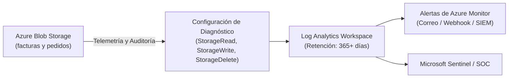

# Auditoría, Monitorización y Consultas KQL: Cumplimiento Normativo en Azure Storage

En entornos regulados sujetos a la **Agencia Estatal de Administración Tributaria (AEAT)**, la **Ley Antifraude (Ley 11/2021)**, el **Reglamento VeriFactu (RD 1007/2023)** y el **RGPD**, las empresas no solo deben asegurar la inmutabilidad física de los datos, sino también garantizar una **pista de auditoría completa, inalterable y auditable de cualquier acceso, intento de modificación o evento administrativo**.

---

## 1. Arquitectura de Diagnóstico y Telemetría



### Categorías de Registro a Habilitar
1. **`StorageRead`**: Registra lecturas y descargas (esencial para auditorías de acceso a datos personales bajo el RGPD).
2. **`StorageWrite`**: Registra creaciones, cargas y adición de bloques (prueba fehaciente de ingesta continua según VeriFactu).
3. **`StorageDelete`**: Registra todos los intentos de borrado (captura intentos anómalos o malintencionados bloqueados por la directiva WORM).
4. **Métricas `Transaction`**: Métricas de rendimiento, latencia de API, volumen transferido y disponibilidad global.

---

## 2. Habilitación de la Configuración de Diagnóstico mediante Azure CLI

```bash
az monitor diagnostic-settings create \
  --name "diag-storage-audit" \
  --resource "/subscriptions/<SUB_ID>/resourceGroups/rg-erp-storage-prod-spaincentral/providers/Microsoft.Storage/storageAccounts/<STORAGE_ACCOUNT>/blobServices/default" \
  --workspace "/subscriptions/<SUB_ID>/resourceGroups/<RG>/providers/Microsoft.OperationalInsights/workspaces/<LOG_ANALYTICS_WORKSPACE>" \
  --logs '[{"category":"StorageRead","enabled":true},{"category":"StorageWrite","enabled":true},{"category":"StorageDelete","enabled":true}]' \
  --metrics '[{"category":"Transaction","enabled":true}]'
```

---

## 3. Consultas Kusto (KQL) Listas para Inspecciones Tributarias y Auditorías

Ejecute estas consultas en **Azure Monitor Log Analytics** sobre la tabla `StorageBlobLogs`:

### Consulta 1: Detección de Intentos Fallidos de Borrado (Violaciones de WORM / Auditoría Antimanipulación)
Detecta cualquier usuario, aplicación o proceso que haya intentado borrar o sobreescribir una factura inmutable:

```kusto
StorageBlobLogs
| where TimeGenerated >= ago(30d)
| where OperationName in ("DeleteBlob", "PutBlob", "PutBlockList")
| where StatusText has "BlobImmutableDueToPolicy" or StatusCode in (409, 412)
| project
    TimeGenerated,
    AccountName,
    Uri,
    OperationName,
    StatusCode,
    StatusText,
    CallerIpAddress,
    UserAgentHeader,
    RequesterUpn = parse_json(AuthenticationType)
| order by TimeGenerated desc
```

---

### Consulta 2: Auditoría de Solicitudes de Rehidratación desde el Nivel Archivo (*Archive*)
Registra cuándo un auditor, perito o usuario solicita el acceso a facturas archivadas de más de 3 años de antigüedad:

```kusto
StorageBlobLogs
| where TimeGenerated >= ago(90d)
| where OperationName == "SetBlobTier"
| extend TargetTier = tostring(parse_json(RequestHeaderParameters).["x-ms-access-tier"])
| where TargetTier in ("Hot", "Cool")
| project
    TimeGenerated,
    AccountName,
    Uri,
    TargetTier,
    CallerIpAddress,
    UserAgentHeader
| order by TimeGenerated desc
```

---

### Consulta 3: Auditoría de Ingesta Diaria para VeriFactu (Prueba de Facturación Continua)
Calcula el cómputo diario de facturas incorporadas y el volumen transferido para la verificación tributaria:

```kusto
StorageBlobLogs
| where TimeGenerated >= ago(30d)
| where OperationName in ("PutBlob", "PutBlockList", "AppendBlock")
| where StatusCode == 201
| summarize
    InvoiceUploads = count(),
    IngestedMegabytes = sum(ResponseBodySize) / 1024 / 1024
    by bin(TimeGenerated, 1d)
| order by TimeGenerated desc
```

---

### Consulta 4: Pista de Auditoría RGPD de Accesos a Facturas Sensibles
Identifica qué direcciones IP e identidades autenticadas descargaron facturas de clientes:

```kusto
StorageBlobLogs
| where TimeGenerated >= ago(7d)
| where OperationName == "GetBlob"
| where Uri has "/facturas/"
| project
    TimeGenerated,
    Uri,
    CallerIpAddress,
    UserAgentHeader,
    ResponseBodySize,
    DurationMs
| order by TimeGenerated desc
```
