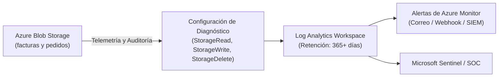

# Auditoría, Monitorización y Consultas KQL: Cumplimiento Normativo en Azure Storage

---

### 🧭 Navegación de la Documentación
| 🏠 [Inicio / README](../README.md) | 🏛️ [Arquitectura](ARCHITECTURE.md) | ⚖️ [Marco Legal](LEGAL_COMPLIANCE_SPAIN.md) | 💰 [Optimización de Costes](COST_OPTIMIZATION.md) | 🔒 [Guía WORM Lock](WORM_POLICY_LOCK_GUIDE.md) | 🖱️ [Manual Portal](AZURE_PORTAL_CLICKOPS_GUIDE.md) | 📊 **Auditoría & KQL** | 🔌 [Integración ERP](ERP_INTEGRATION_AND_REHYDRATION.md) |
| :---: | :---: | :---: | :---: | :---: | :---: | :---: | :---: |

---

En entornos regulados sujetos a la **Agencia Estatal de Administración Tributaria (AEAT)**, la **Ley Antifraude (Ley 11/2021)**, el **Reglamento VeriFactu (RD 1007/2023)** y el **RGPD**, las empresas no solo deben asegurar la inmutabilidad física de los datos, sino también garantizar una **pista de auditoría completa, inalterable y auditable de cualquier acceso, intento de modificación o evento administrativo**.

---

## 📑 Tabla de Contenidos
1. [Arquitectura de Diagnóstico y Telemetría](#1-arquitectura-de-diagnóstico-y-telemetría)
   * 1.1. [Categorías de Registro a Habilitar](#categorías-de-registro-a-habilitar)
2. [Habilitación de la Configuración de Diagnóstico mediante Azure CLI](#2-habilitación-de-la-configuración-de-diagnóstico-mediante-azure-cli)
3. [Consultas Kusto (KQL) Listas para Inspecciones Tributarias y Auditorías](#3-consultas-kusto-kql-listas-para-inspecciones-tributarias-y-auditorías)
   * 3.1. [Consulta 1: Detección de Intentos Fallidos de Borrado (WORM)](#consulta-1-detección-de-intentos-fallidos-de-borrado-violaciones-de-worm--auditoría-antimanipulación)
   * 3.2. [Consulta 2: Auditoría de Solicitudes de Rehidratación (Archive)](#consulta-2-auditoría-de-solicitudes-de-rehidratación-desde-el-nivel-archivo-archive)
   * 3.3. [Consulta 3: Auditoría de Ingesta Diaria (VeriFactu)](#consulta-3-auditoría-de-ingesta-diaria-para-verifactu-prueba-de-facturación-continua)
   * 3.4. [Consulta 4: Pista de Auditoría RGPD de Accesos a Facturas](#consulta-4-pista-de-auditoría-rgpd-de-accesos-a-facturas-sensibles)
4. [Navegación entre Módulos de Documentación](#-navegación-entre-módulos)

---

## 1. Arquitectura de Diagnóstico y Telemetría



### Categorías de Registro a Habilitar
1. **`StorageRead`**: Registra lecturas y descargas (esencial para auditorías de acceso a datos personales bajo el RGPD).
2. **`StorageWrite`**: Registra creaciones, cargas y adición de bloques (prueba fehaciente de ingesta continua según VeriFactu).
3. **`StorageDelete`**: Registra todos los intentos de borrado (captura intentos anómalos o malintencionados bloqueados por la directiva WORM).
4. **Métricas `Transaction`**: Métricas de rendimiento, latencia de API, volumen transferido y disponibilidad global.

---

## 2. Habilitación de la Configuración de Diagnóstico mediante Azure CLI

```bash
az monitor diagnostic-settings create \
  --name "diag-storage-audit" \
  --resource "/subscriptions/<SUB_ID>/resourceGroups/rg-erp-storage-prod-spaincentral/providers/Microsoft.Storage/storageAccounts/<STORAGE_ACCOUNT>/blobServices/default" \
  --workspace "/subscriptions/<SUB_ID>/resourceGroups/<RG>/providers/Microsoft.OperationalInsights/workspaces/<LOG_ANALYTICS_WORKSPACE>" \
  --logs '[{"category":"StorageRead","enabled":true},{"category":"StorageWrite","enabled":true},{"category":"StorageDelete","enabled":true}]' \
  --metrics '[{"category":"Transaction","enabled":true}]'
```

---

## 3. Consultas Kusto (KQL) Listas para Inspecciones Tributarias y Auditorías

Ejecute estas consultas en **Azure Monitor Log Analytics** sobre la tabla `StorageBlobLogs`:

### Consulta 1: Detección de Intentos Fallidos de Borrado (Violaciones de WORM / Auditoría Antimanipulación)
Detecta cualquier usuario, aplicación o proceso que haya intentado borrar o sobreescribir una factura inmutable:

```kusto
StorageBlobLogs
| where TimeGenerated >= ago(30d)
| where OperationName in ("DeleteBlob", "PutBlob", "PutBlockList")
| where StatusText has "BlobImmutableDueToPolicy" or StatusCode in (409, 412)
| project
    TimeGenerated,
    AccountName,
    Uri,
    OperationName,
    StatusCode,
    StatusText,
    CallerIpAddress,
    UserAgentHeader,
    RequesterUpn = parse_json(AuthenticationType)
| order by TimeGenerated desc
```

---

### Consulta 2: Auditoría de Solicitudes de Rehidratación desde el Nivel Archivo (*Archive*)
Registra cuándo un auditor, perito o usuario solicita el acceso a facturas archivadas de más de 3 años de antigüedad:

```kusto
StorageBlobLogs
| where TimeGenerated >= ago(90d)
| where OperationName == "SetBlobTier"
| extend TargetTier = tostring(parse_json(RequestHeaderParameters).["x-ms-access-tier"])
| where TargetTier in ("Hot", "Cool")
| project
    TimeGenerated,
    AccountName,
    Uri,
    TargetTier,
    CallerIpAddress,
    UserAgentHeader
| order by TimeGenerated desc
```

---

### Consulta 3: Auditoría de Ingesta Diaria para VeriFactu (Prueba de Facturación Continua)
Calcula el cómputo diario de facturas incorporadas y el volumen transferido para la verificación tributaria:

```kusto
StorageBlobLogs
| where TimeGenerated >= ago(30d)
| where OperationName in ("PutBlob", "PutBlockList", "AppendBlock")
| where StatusCode == 201
| summarize
    InvoiceUploads = count(),
    IngestedMegabytes = sum(ResponseBodySize) / 1024 / 1024
    by bin(TimeGenerated, 1d)
| order by TimeGenerated desc
```

---

### Consulta 4: Pista de Auditoría RGPD de Accesos a Facturas Sensibles
Identifica qué direcciones IP e identidades autenticadas descargaron facturas de clientes:

```kusto
StorageBlobLogs
| where TimeGenerated >= ago(7d)
| where OperationName == "GetBlob"
| where Uri has "/facturas/"
| project
    TimeGenerated,
    Uri,
    CallerIpAddress,
    UserAgentHeader,
    ResponseBodySize,
    DurationMs
| order by TimeGenerated desc
```

---

## 🧭 Navegación entre Módulos

* ⬅️ **Anterior**: [Manual Paso a Paso en Azure Portal (ClickOps)](AZURE_PORTAL_CLICKOPS_GUIDE.md)
* 🏠 **Inicio**: [README Principal](../README.md)
* ➡️ **Siguiente**: [Guía de Integración ERP y Rehidratación](ERP_INTEGRATION_AND_REHYDRATION.md)
* 📑 **Índice Completo de Documentación**:
  1. 🏛️ [Arquitectura Técnica](ARCHITECTURE.md)
  2. ⚖️ [Marco Legal y Cumplimiento Normativo (España y UE)](LEGAL_COMPLIANCE_SPAIN.md)
  3. 💰 [Análisis Financiero y Optimización de Costes (TCO)](COST_OPTIMIZATION.md)
  4. 🔒 [Guía Operativa del Bloqueo WORM (Policy Lock)](WORM_POLICY_LOCK_GUIDE.md)
  5. 🖱️ [Manual Paso a Paso en Azure Portal (ClickOps)](AZURE_PORTAL_CLICKOPS_GUIDE.md)
  6. 📊 **Auditoría, Monitorización y Consultas KQL** (Documento actual)
  7. 🔌 [Guía de Integración ERP y Rehidratación](ERP_INTEGRATION_AND_REHYDRATION.md)

