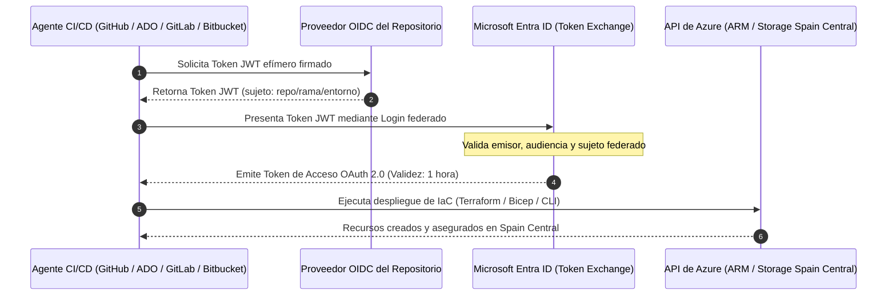
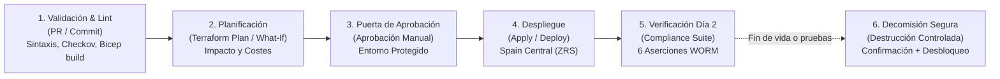

# Automatización CI/CD Multiplataforma: GitHub Actions, Azure DevOps, GitLab y Bitbucket

---

### 🧭 Navegación de la Documentación
| 🏠 [Inicio / README](../README.md) | 🏛️ [Arquitectura](ARCHITECTURE.md) | ⚖️ [Marco Legal](LEGAL_COMPLIANCE_SPAIN.md) | 💰 [Optimización de Costes](COST_OPTIMIZATION.md) | 🔒 [Guía WORM Lock](WORM_POLICY_LOCK_GUIDE.md) | 🖱️ [Manual Portal](AZURE_PORTAL_CLICKOPS_GUIDE.md) | 📊 [Auditoría & KQL](AUDITING_AND_MONITORING.md) | 🔌 [Integración ERP](ERP_INTEGRATION_AND_REHYDRATION.md) | 🚀 **Guía CI/CD** |
| :---: | :---: | :---: | :---: | :---: | :---: | :---: | :---: | :---: |

---

Este documento detalla la arquitectura, configuración y operativa de los pipelines de **Integración Continua y Despliegue Continuo (CI/CD)** para todas las soluciones de Infraestructura como Código (Terraform, Bicep, Azure CLI, Ansible y PowerShell) contempladas en este repositorio.

Se cubren de forma exhaustiva cuatro plataformas líderes del sector: **GitHub Actions**, **Azure DevOps Pipelines**, **GitLab CI/CD** y **Bitbucket Pipelines**, adoptando el estándar moderno de seguridad **Zero Trust mediante federación de identidades OIDC** (sin contraseñas ni secretos estáticos de larga duración).

---

## 📑 Tabla de Contenidos

1. [Arquitectura de Autenticación Zero Trust con OIDC (Sin Secretos)](#1-arquitectura-de-autenticación-zero-trust-con-oidc-sin-secretos)
2. [Ciclo de Vida Completo de la Infraestructura](#2-ciclo-de-vida-completo-de-la-infraestructura)
3. [Configuración en GitHub Actions](#3-configuración-en-github-actions)
   * 3.1. [Credenciales Federadas en Microsoft Entra ID](#31-credenciales-federadas-en-microsoft-entra-id)
   * 3.2. [Workflows Incluidos en el Repositorio](#32-workflows-incluidos-en-el-repositorio)
4. [Configuración en Azure DevOps Pipelines](#4-configuración-en-azure-devops-pipelines)
   * 4.1. [Service Connection con Workload Identity Federation](#41-service-connection-con-workload-identity-federation)
   * 4.2. [Pipelines YAML Multi-Etapa](#42-pipelines-yaml-multi-etapa)
5. [Configuración en GitLab CI/CD](#5-configuración-en-gitlab-cicd)
   * 5.1. [Federación con id_tokens de GitLab](#51-federación-con-id_tokens-de-gitlab)
   * 5.2. [Estructura Modular de Jobs](#52-estructura-modular-de-jobs)
6. [Configuración en Bitbucket Pipelines](#6-configuración-en-bitbucket-pipelines)
7. [Protocolo de Decomisión Segura y Salvaguardas WORM](#7-protocolo-de-decomisión-segura-y-salvaguardas-worm)
8. [Matriz Comparativa de Capacidades CI/CD](#8-matriz-comparativa-de-capacidades-cicd)
9. [Navegación entre Módulos de Documentación](#-navegación-entre-módulos)

---

## 1. Arquitectura de Autenticación Zero Trust con OIDC (Sin Secretos)

El uso de secretos de cliente (*client secrets*) o certificados con contraseñas almacenadas en los repositorios de CI/CD representa un vector crítico de fuga de credenciales. Esta arquitectura implementa **Workload Identity Federation (OIDC)** con **Microsoft Entra ID**:



### Principios de Seguridad Aplicados
1. **Sin Secretos de Larga Duración**: Ningún pipeline almacena contraseñas; los tokens OIDC expiran automáticamente a los pocos minutos.
2. **Principio de Mínimo Privilegio**: La identidad administrada o el *Service Principal* solo posee permisos en el grupo de recursos `rg-erp-storage-prod-spaincentral`.
3. **Validación Criptográfica de la Rama**: Solo la rama protegida `main` o entornos específicos pueden solicitar tokens con permisos de escritura.

---

## 2. Ciclo de Vida Completo de la Infraestructura

Los pipelines implementan las cuatro fases indispensables para entornos regulados de finanzas y facturación:



---

## 3. Configuración en GitHub Actions

El directorio [`.github/workflows/`](../.github/workflows/) contiene tres flujos de trabajo listos para producción:

### 3.1. Credenciales Federadas en Microsoft Entra ID
Para habilitar GitHub Actions sin secretos, cree la credencial federada mediante Azure CLI:

```bash
# 1. Crear el Service Principal
APP_ID=$(az ad app create --display-name "sp-github-erp-storage" --query appId -o tsv)
SP_ID=$(az ad sp create --id "$APP_ID" --query id -o tsv)

# 2. Asignar rol de Colaborador en el Grupo de Recursos
SUB_ID=$(az account show --query id -o tsv)
az role assignment create \
  --role "Contributor" \
  --assignee "$APP_ID" \
  --scope "/subscriptions/$SUB_ID/resourceGroups/rg-erp-storage-prod-spaincentral"

# 3. Crear la credencial federada para la rama main
cat <<EOF > gh-federated-cred.json
{
  "name": "gh-actions-main-branch",
  "issuer": "https://token.actions.githubusercontent.com",
  "subject": "repo:nubenetes/azure-storage-erp-compliance-iac:ref:refs/heads/main",
  "description": "Acceso OIDC desde rama main",
  "audiences": ["api://AzureADTokenExchange"]
}
EOF
az ad app federated-credential create --id "$APP_ID" --parameters gh-federated-cred.json
```

### 3.2. Workflows Incluidos en el Repositorio
* [`.github/workflows/deploy-terraform.yml`](../.github/workflows/deploy-terraform.yml):
  * **Plan**: Se ejecuta en cada Pull Request.
  * **Apply**: Se ejecuta al fusionar en `main` bajo el entorno `production`.
  * **Destroy**: Ejecutable manualmente mediante `workflow_dispatch` exigiendo la frase de confirmación: `CONFIRM-DECOMMISSION-ERP-STORAGE`.
* [`.github/workflows/deploy-bicep.yml`](../.github/workflows/deploy-bicep.yml):
  * Ejecuta `az bicep build` y `az deployment group what-if` antes del despliegue productivo.
* [`.github/workflows/deploy-iac-orchestrator.yml`](../.github/workflows/deploy-iac-orchestrator.yml):
  * Orquestador multi-herramienta que permite elegir entre Azure CLI, PowerShell, Ansible, Bicep y Terraform.

---

## 4. Configuración en Azure DevOps Pipelines

El directorio [`azure-pipelines/`](../azure-pipelines/) contiene la configuración declarativa en formato YAML para Azure Pipelines:

### 4.1. Service Connection con Workload Identity Federation
1. En **Azure DevOps** $\rightarrow$ **Project Settings** $\rightarrow$ **Service connections**.
2. Seleccione **New service connection** $\rightarrow$ **Azure Resource Manager**.
3. Elija el método de autenticación: **Workload Identity federation (automatic)** o **Workload Identity federation (manual)**.
4. Nombre de la conexión: `sc-azure-spaincentral-oidc`.
5. Nivel de ámbito: Suscripción o Grupo de Recursos `rg-erp-storage-prod-spaincentral`.

### 4.2. Pipelines YAML Multi-Etapa
* [`azure-pipelines/azure-pipelines-terraform.yml`](../azure-pipelines/azure-pipelines-terraform.yml):
  * Estructurado en 3 etapas: `ValidateAndPlan` $\rightarrow$ `DeployProduction` $\rightarrow$ `DecommissionSafe`.
  * Integra la tarea oficial `AzureCLI@2` y `TerraformInstaller@1`.
* [`azure-pipelines/azure-pipelines-bicep.yml`](../azure-pipelines/azure-pipelines-bicep.yml):
  * Gestiona el ciclo completo de Bicep con simulación `what-if`.
* [`azure-pipelines/azure-pipelines-orchestrator.yml`](../azure-pipelines/azure-pipelines-orchestrator.yml):
  * Permite ejecutar tareas en Ansible (`azure.azcollection`), PowerShell Az (`AzurePowerShell@5`) y Azure CLI.

---

## 5. Configuración en GitLab CI/CD

El archivo principal [`.gitlab-ci.yml`](../.gitlab-ci.yml) y sus módulos en [`.gitlab/ci/`](../.gitlab/ci/) proporcionan soporte nativo para GitLab:

### 5.1. Federación con `id_tokens` de GitLab
GitLab emite tokens JWT mediante el bloque `id_tokens`. Para autorizarlo en Microsoft Entra ID:

```json
{
  "name": "gitlab-ci-main-branch",
  "issuer": "https://gitlab.com",
  "subject": "project_path:nubenetes/azure-storage-erp-compliance-iac:ref_type:branch:ref:main",
  "description": "Federación OIDC GitLab CI",
  "audiences": ["api://AzureADTokenExchange"]
}
```

### 5.2. Estructura Modular de Jobs
* [`.gitlab/ci/terraform.gitlab-ci.yml`](../.gitlab/ci/terraform.gitlab-ci.yml): Contiene jobs aislados para `tf:lint_and_plan`, `tf:apply_production` (con botón de aprobación manual) y `tf:destroy_safe`.
* [`.gitlab/ci/bicep-azurecli.gitlab-ci.yml`](../.gitlab/ci/bicep-azurecli.gitlab-ci.yml): Ejecuta despliegues idempotentes de CLI, compilación de Bicep y la suite de pruebas `compliance:verify_worm`.

---

## 6. Configuración en Bitbucket Pipelines

El archivo [`bitbucket-pipelines.yml`](../bitbucket-pipelines.yml) implementa la automatización para repositorios alojados en Atlassian Bitbucket:

* **Activación de OIDC**: Cada paso declara `oidc: true`.
* **Variable de Entorno Automática**: Bitbucket inyecta `$BITBUCKET_STEP_OIDC_TOKEN`, que se envía directamente a `az login --federated-token`.
* **Puertas de Aprobación**: Los despliegues a producción requieren validación manual mediante `trigger: manual` y el entorno `deployment: production`.

---

## 7. Protocolo de Decomisión Segura y Salvaguardas WORM

> [!CAUTION]
> **COMPORTAMIENTO ANTE EL BORRADO EN ENTORNOS CON ALMACENAMIENTO INMUTABLE**
> 
> En este proyecto se configuran dos capas de protección contra eliminación:
> 1. **Bloqueo de Gestión de Azure (`CanNotDelete`)**: Impide que llamadas a la API de ARM o scripts eliminen la cuenta de almacenamiento o el grupo de recursos.
> 2. **Directiva Inmutable WORM de Retención Temporal (2.190 días / 6 años)**: Si la directiva se encuentra en estado **LOCKED**, Azure denegará irrevocablemente cualquier intento de borrado de facturas o contenedores, incluso si se elimina el bloqueo de gestión.

### Mecánica de Decomisión Implementada en Todos los Pipelines
Cuando se requiera desmantelar un entorno de pruebas o finalizar el ciclo de vida:
1. **Comprobación de Seguridad**: El operador debe introducir obligatoriamente la frase textual:  
   `CONFIRM-DECOMMISSION-ERP-STORAGE`.
2. **Liberación Previa del Bloqueo CanNotDelete**: El pipeline ejecuta automáticamente la consulta y eliminación del candado de gestión mediante Azure CLI:
   ```bash
   LOCK_ID=$(az lock list --resource-group "$RG" --query "[?level=='CanNotDelete'].id" -o tsv)
   if [ -n "$LOCK_ID" ]; then
     az lock delete --ids $LOCK_ID
   fi
   ```
3. **Evaluación de la Directiva WORM**: Si el contenedor está en modo *Unlocked*, los recursos se destruyen limpiamente. Si está en modo *Locked*, la plataforma Azure rechazará la operación protegiendo los datos mercantiles y fiscales con plena garantía legal.

---

## 8. Matriz Comparativa de Capacidades CI/CD

| Característica / Plataforma | GitHub Actions | Azure DevOps | GitLab CI/CD | Bitbucket Pipelines |
| :--- | :---: | :---: | :---: | :---: |
| **Autenticación Segura OIDC** | ✅ Nativo (`id-token: write`) | ✅ Nativo (Workload Identity) | ✅ Nativo (`id_tokens`) | ✅ Nativo (`oidc: true`) |
| **Gestión de Secretos** | Cero contraseñas fijas | Cero contraseñas fijas | Cero contraseñas fijas | Cero contraseñas fijas |
| **Simulación de Cambios** | Terraform Plan / What-If | Terraform Plan / What-If | Terraform Plan / What-If | Terraform Plan / What-If |
| **Puertas de Aprobación Manual** | Environments (`production`) | Environments & Approvals | `when: manual` | `trigger: manual` |
| **Soporte Multi-IaC** | Terraform, Bicep, CLI, PS, Ansible | Terraform, Bicep, CLI, PS, Ansible | Terraform, Bicep, CLI | Terraform, Bicep, CLI |
| **Suite de Cumplimiento Día 2** | ✅ Verificación WORM en CI | ✅ Verificación WORM en CI | ✅ Verificación WORM en CI | ✅ Verificación WORM en CI |
| **Decomisión con Salvaguardas** | ✅ Con frase de confirmación | ✅ Con frase de confirmación | ✅ Con variable obligatoria | ✅ Con variable obligatoria |

---

## 🧭 Navegación entre Módulos

* ⬅️ **Anterior**: [Guía de Integración ERP y Rehidratación](ERP_INTEGRATION_AND_REHYDRATION.md)
* 🏠 **Inicio**: [README Principal](../README.md)
* 📑 **Índice Completo de Documentación**:
  1. 🏛️ [Arquitectura Técnica](ARCHITECTURE.md)
  2. ⚖️ [Marco Legal y Cumplimiento Normativo (España y UE)](LEGAL_COMPLIANCE_SPAIN.md)
  3. 💰 [Análisis Financiero y Optimización de Costes (TCO)](COST_OPTIMIZATION.md)
  4. 🔒 [Guía Operativa del Bloqueo WORM (Policy Lock)](WORM_POLICY_LOCK_GUIDE.md)
  5. 🖱️ [Manual Paso a Paso en Azure Portal (ClickOps)](AZURE_PORTAL_CLICKOPS_GUIDE.md)
  6. 📊 [Auditoría, Monitorización y Consultas KQL](AUDITING_AND_MONITORING.md)
  7. 🔌 [Guía de Integración ERP y Rehidratación](ERP_INTEGRATION_AND_REHYDRATION.md)
  8. 🚀 **Automatización CI/CD Multiplataforma** (Documento actual)
