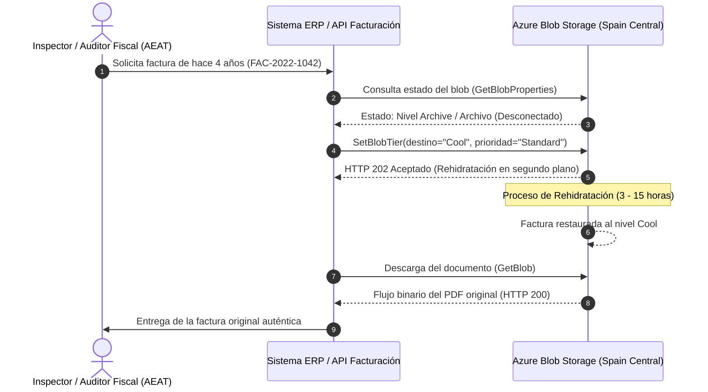

# Guía de Integración ERP y Rehidratación desde el Nivel Archivo

---

### 🧭 Navegación de la Documentación
| 🏠 [Inicio / README](../README.md) | 🏛️ [Arquitectura](ARCHITECTURE.md) | ⚖️ [Marco Legal](LEGAL_COMPLIANCE_SPAIN.md) | 💰 [Optimización de Costes](COST_OPTIMIZATION.md) | 🔒 [Guía WORM Lock](WORM_POLICY_LOCK_GUIDE.md) | 🖱️ [Manual Portal](AZURE_PORTAL_CLICKOPS_GUIDE.md) | 📊 [Auditoría & KQL](AUDITING_AND_MONITORING.md) | 🔌 **Integración ERP** |
| :---: | :---: | :---: | :---: | :---: | :---: | :---: | :---: |

---

Esta guía detalla cómo los sistemas ERP empresariales (SAP, Microsoft Dynamics 365, Navision, Odoo o microservicios a medida) interactúan con la cuenta de almacenamiento inmutable WORM y gestionan la **rehidratación** de facturas históricas archivadas.

---

## 📑 Tabla de Contenidos
1. [Autenticación: Modelo Zero Trust y Microsoft Entra ID (RBAC)](#1-autenticación-modelo-zero-trust-y-microsoft-entra-id-rbac)
2. [Metadatos Recomendados y Etiquetas de Índice (Blob Index Tags)](#2-metadatos-recomendados-y-etiquetas-de-índice-blob-index-tags)
3. [Rehidratación desde el Nivel Archivo (Archive Tier)](#3-rehidratación-desde-el-nivel-archivo-archive-tier)
   * 3.1. [Opciones de Prioridad y Latencia de Rehidratación](#opciones-de-prioridad-y-latencia-de-rehidratación)
   * 3.2. [Rehidratación Mediante Azure CLI](#rehidratación-mediante-azure-cli)
4. [Navegación entre Módulos de Documentación](#-navegación-entre-módulos)

---

## 1. Autenticación: Modelo Zero Trust y Microsoft Entra ID (RBAC)

**Nunca** incruste ni almacene claves fijas de cuenta de almacenamiento (*Storage Account Keys*) en el código fuente ni en ficheros de configuración del ERP. En su lugar, utilice el control de acceso basado en roles **Microsoft Entra ID RBAC**:

* **Para aplicaciones en Azure (VMs, AKS, Azure App Service)**: Asigne una **Identidad Administrada Asignada por el Usuario (*User-Assigned Managed Identity*)**.
* **Para ERPs locales (*On-Premises*) o multi-cloud**: Utilice un **Registro de Aplicación en Microsoft Entra ID (*Service Principal*)** autenticado mediante certificado X.509 o federación OpenID Connect (OIDC).
* **Rol RBAC Mínimo Requerido**: `Colaborador de datos de Storage Blob (Storage Blob Data Contributor)`. Este rol autoriza la subida de blobs y la anexión de bloques, pero no puede eludir ni anular las directivas de inmutabilidad WORM.

---

## 2. Metadatos Recomendados y Etiquetas de Índice (*Blob Index Tags*)

Al subir cada factura, adjunte tanto **Metadatos** como **Etiquetas de Índice (*Blob Index Tags*)**. Las etiquetas de índice permiten realizar búsquedas parametrizadas por atributos sin necesidad de escanear millones de archivos:

| Clave de Etiqueta (*Tag*) | Valor de Ejemplo | Descripción |
| :--- | :--- | :--- |
| `InvoiceNumber` | `FAC-2026-004812` | Número de serie y correlación fiscal oficial de la factura. |
| `FiscalYear` | `2026` | Ejercicio fiscal y contable correspondiente. |
| `CustomerTaxID` | `B12345678` | NIF/CIF de la entidad receptora de la factura. |
| `VeriFactuChainHash`| `e3b0c44298fc1c149afbf4c8996fb92427ae41e4649b934ca495991b7852b855` | Huella digital SHA-256 encadenada al registro anterior. |
| `DocumentType` | `FacturaExpedida` | Tipología documental según el reglamento de facturación español. |

---

## 3. Rehidratación desde el Nivel Archivo (*Archive Tier*)

Las facturas con más de 3 años de antigüedad (1.095 días) residen en el **Nivel Archivo (*Archive Tier*)** (~0,00099 €/GB/mes). Se encuentran desconectadas (*offline*) y requieren un proceso de rehidratación previo para poder descargarse y visualizarse.

### Opciones de Prioridad y Latencia de Rehidratación

| Nivel de Prioridad | Latencia en Spain Central | Coste por GB Recuperado | Recomendado Para |
| :--- | :--- | :--- | :--- |
| **Prioridad Estándar (*Standard*)** | **3 a 15 horas** | ~0,022 € / GB | Peticiones ordinarias de auditoría o revisiones contables anuales. |
| **Alta Prioridad (*High Priority*)** | **< 1 hora** (para blobs < 10 GB) | ~0,110 € / GB | Requerimientos judiciales urgentes o inspecciones tributarias presenciales. |



### Rehidratación Mediante Azure CLI

```bash
# Rehidratar una factura histórica al nivel Esporádico (Cool)
az storage blob set-tier \
  --account-name sterpspainprod01 \
  --container-name facturas \
  --name "facturas/2022/FAC-2022-1042.pdf" \
  --tier Cool \
  --rehydrate-priority Standard \
  --auth-mode login
```

---

## 🧭 Navegación entre Módulos

* ⬅️ **Anterior**: [Auditoría, Monitorización y Consultas KQL](AUDITING_AND_MONITORING.md)
* 🏠 **Inicio**: [README Principal](../README.md)
* 📑 **Índice Completo de Documentación**:
  1. 🏛️ [Arquitectura Técnica](ARCHITECTURE.md)
  2. ⚖️ [Marco Legal y Cumplimiento Normativo (España y UE)](LEGAL_COMPLIANCE_SPAIN.md)
  3. 💰 [Análisis Financiero y Optimización de Costes (TCO)](COST_OPTIMIZATION.md)
  4. 🔒 [Guía Operativa del Bloqueo WORM (Policy Lock)](WORM_POLICY_LOCK_GUIDE.md)
  5. 🖱️ [Manual Paso a Paso en Azure Portal (ClickOps)](AZURE_PORTAL_CLICKOPS_GUIDE.md)
  6. 📊 [Auditoría, Monitorización y Consultas KQL](AUDITING_AND_MONITORING.md)
  7. 🔌 **Guía de Integración ERP y Rehidratación** (Documento actual)

