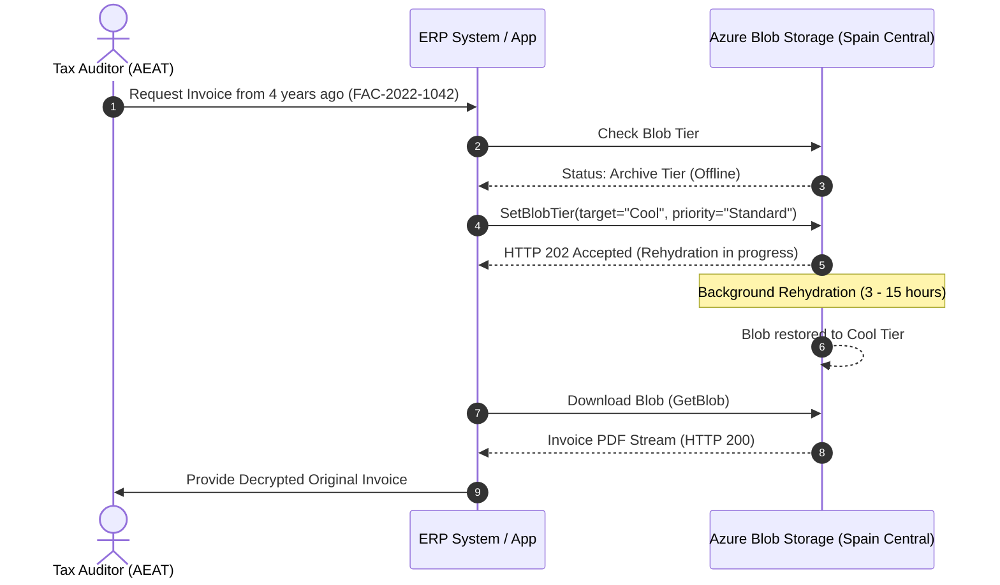

# ERP Integration & Archive Rehydration Guide

This guide details how enterprise ERP systems (SAP, Microsoft Dynamics, Navision, Odoo, or custom microservices) interact with the compliant WORM storage account and manage **rehydration** of archived historical documents.

---

## 1. Authentication: Zero Trust & Microsoft Entra ID

Do **not** hardcode storage account keys in ERP application code or configuration files. Instead, use **Microsoft Entra ID RBAC**:

* **For Azure VMs / AKS / App Services**: Assign a **User-Assigned Managed Identity**.
* **For On-Premises ERPs**: Use a **Microsoft Entra ID App Registration** (Service Principal) with certificate authentication or OpenID Connect (OIDC) federation.
* **Assigned RBAC Role**: `Storage Blob Data Contributor` (allows uploads and append blocks; cannot bypass WORM immutability policies).

---

## 2. Recommended Metadata & Blob Index Tags

When uploading an invoice, attach both **Metadata** and **Blob Index Tags**. Blob Index Tags allow query-based indexing without scanning millions of files:

| Tag Key | Example Value | Description |
| :--- | :--- | :--- |
| `InvoiceNumber` | `FAC-2026-004812` | Official fiscal invoice sequence number. |
| `FiscalYear` | `2026` | Fiscal accounting year. |
| `CustomerTaxID` | `B12345678` | NIF/CIF of the recipient entity. |
| `VeriFactuChainHash`| `e3b0c44298fc1c149afbf4c8996fb92427ae41e4649b934ca495991b7852b855` | SHA-256 hash chaining to the preceding invoice. |
| `DocumentType` | `FacturaExpedida` | Invoice category under Spanish billing regulations. |

---

## 3. Rehydration from Archive Tier (Audits & Historical Queries)

Blobs older than 3 years (1,095 days) reside in the **Archive Tier** (~0.00099 €/GB/month). They are offline and must be rehydrated before they can be read.

### Rehydration Latency & Priority Options

| Priority Level | Latency in Spain Central | Cost per GB Retrieved | Recommended For |
| :--- | :--- | :--- | :--- |
| **Standard Priority** | **3 to 15 hours** | ~0.022 € / GB | Regular audit requests, annual tax reviews. |
| **High Priority** | **< 1 hour** (blobs < 10 GB) | ~0.110 € / GB | Urgent legal requirements, immediate tax inspections. |



### Rehydration via Azure CLI
```bash
# Rehydrate a single historical invoice to Cool tier
az storage blob set-tier \
  --account-name sterpspainprod01 \
  --container-name facturas \
  --name "facturas/2022/FAC-2022-1042.pdf" \
  --tier Cool \
  --rehydrate-priority Standard \
  --auth-mode login
```
