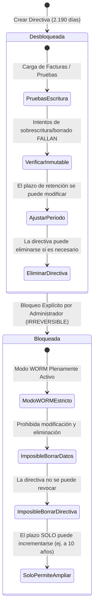

# Guía Operativa: Directiva de Inmutabilidad WORM y Mecánica de Bloqueo Definitivo (*Policy Lock*)

---

### 🧭 Navegación de la Documentación
| 🏠 [Inicio / README](../README.md) | 🏛️ [Arquitectura](ARCHITECTURE.md) | ⚖️ [Marco Legal](LEGAL_COMPLIANCE_SPAIN.md) | 💰 [Optimización de Costes](COST_OPTIMIZATION.md) | 🔒 **Guía WORM Lock** | 🖱️ [Manual Portal](AZURE_PORTAL_CLICKOPS_GUIDE.md) | 📊 [Auditoría & KQL](AUDITING_AND_MONITORING.md) | 🔌 [Integración ERP](ERP_INTEGRATION_AND_REHYDRATION.md) |
| :---: | :---: | :---: | :---: | :---: | :---: | :---: | :---: |

---

> [!CAUTION]
> **LEA CON ATENCIÓN ANTES DE EJECUTAR UN BLOQUEO DE DIRECTIVA (*POLICY LOCK*) EN PRODUCCIÓN**
> 
> Una vez que una directiva de inmutabilidad en Azure Blob Storage pasa a estado **BLOQUEADA (*LOCKED*)**, la transición es **ESTRICTAMENTE IRREVERSIBLE**.
> **Absolutamente nadie** —incluyendo el Propietario de la Suscripción (*Subscription Owner*), el Administrador Global de Microsoft Entra o el soporte técnico y de ingeniería de Microsoft Azure— posee la capacidad técnica o administrativa de anular la directiva, acortar el plazo de retención ni eliminar los contenedores o facturas protegidas hasta que haya transcurrido íntegramente el periodo configurado (por ejemplo, 2.190 días / 6 años naturales).

---

## 📑 Tabla de Contenidos
1. [Ciclo de Vida de la Directiva de Inmutabilidad: Desbloqueada (Unlocked) vs. Bloqueada (Locked)](#1-ciclo-de-vida-de-la-directiva-de-inmutabilidad-desbloqueada-unlocked-vs-bloqueada-locked)
   * 1.1. [Matriz Comparativa de Estados](#matriz-comparativa-de-estados)
2. [Lista de Comprobación de Seguridad Previa al Bloqueo (Pre-Lock Checklist)](#2-lista-de-comprobación-de-seguridad-previa-al-bloqueo-pre-lock-checklist)
3. [Procedimiento para Bloquear la Directiva (Lock Policy)](#3-procedimiento-para-bloquear-la-directiva-lock-policy)
   * 3.1. [Opción A: Mediante el Script de Azure CLI Incluido](#opción-a-mediante-el-script-de-azure-cli-incluido-recomendado)
   * 3.2. [Opción B: Mediante el Script de PowerShell](#opción-b-mediante-el-script-de-powershell)
   * 3.3. [Opción C: Mediante Terraform](#opción-c-mediante-terraform)
   * 3.4. [Opción D: A través del Portal de Azure](#opción-d-a-través-del-portal-de-azure-interfaz-gráfica)
4. [Navegación entre Módulos de Documentación](#-navegación-entre-módulos)

---

## 1. Ciclo de Vida de la Directiva de Inmutabilidad: Desbloqueada (*Unlocked*) vs. Bloqueada (*Locked*)

Azure Blob Storage proporciona dos estados operativos para las directivas de retención temporal:



### Matriz Comparativa de Estados

| Capacidad / Atributo | Estado Desbloqueado (*Unlocked* - Por defecto en IaC) | Estado Bloqueado (*Locked* - Modo Legal Producción) |
| :--- | :--- | :--- |
| **Eliminación de Blobs Prohibida** | ✅ Sí (durante el periodo de retención) | ✅ Sí (durante el periodo de retención) |
| **Sobrescritura de Blobs Prohibida** | ✅ Sí | ✅ Sí |
| **Escrituras Adicionales (*Append Blobs*) Permitidas** | ✅ Sí (si está habilitado `allowProtectedAppendWrites`) | ✅ Sí (si está habilitado `allowProtectedAppendWrites`) |
| **La Directiva Puede Eliminarse** | ✅ Sí (por administradores autorizados) | ❌ **NO (Técnicamente imposible)** |
| **El Plazo de Retención Puede Acortarse** | ✅ Sí | ❌ **NO (Técnicamente imposible)** |
| **El Plazo de Retención Puede Ampliarse** | ✅ Sí | ✅ Sí (puede ampliarse hasta un máximo de 146.000 días) |
| **El Contenedor Puede Eliminarse** | ❌ Solo si está completamente vacío | ❌ Solo si está vacío y todas las retenciones han expirado |
| **La Cuenta de Almacenamiento Puede Eliminarse** | ❌ Bloqueada si contiene blobs protegidos | ❌ Bloqueada hasta que todos los blobs protegidos expiren |
| **Validez Regulatoria (SEC 17a-4 / VeriFactu / Ley Antifraude)** | ⚠️ Cumplimiento preliminar (directiva mutable) | ✅ **100% Cumplimiento Legal Estricto (WORM inmutable)** |

---

## 2. Lista de Comprobación de Seguridad Previa al Bloqueo (*Pre-Lock Checklist*)

Antes de realizar la transición de la directiva de inmutabilidad de un contenedor de `Unlocked` a `Locked`, complete rigurosamente los siguientes puntos:

1. [ ] **Nomenclatura del Contenedor**: Confirme que el nombre del contenedor (`facturas` o `pedidos`) se ajusta al estándar corporativo definitivo.
2. [ ] **Duración de la Retención**: Valide que `2190` días (6 años) es el periodo pactado con la asesoría fiscal y jurídica de la empresa.
3. [ ] **Configuración de Blobs de Anexado (*Append Blobs*)**: Verifique que `allowProtectedAppendWrites = true` está activo si el ERP o el motor VeriFactu registran eventos y hashes secuenciales en los archivos.
4. [ ] **Contrato y Facturación de la Suscripción**: Asegúrese de que la suscripción de Azure forma parte de un acuerdo corporativo estable (*Enterprise Agreement*, *MCA* o *CSP*) para evitar la cancelación involuntaria de la suscripción mientras existan blobs retenidos.
5. [ ] **Prueba Práctica de Inmutabilidad**: Suba un documento ficticio de prueba y verifique que el comando `az storage blob delete` o el intento de borrado desde el portal es rechazado con el código HTTP `409 BlobImmutableDueToPolicy`.

---

## 3. Procedimiento para Bloquear la Directiva (*Lock Policy*)

Este repositorio proporciona scripts y configuraciones automatizadas para ejecutar el bloqueo de forma controlada.

### Opción A: Mediante el Script de Azure CLI Incluido (Recomendado)

Ejecute el script interactivo con salvaguardas de confirmación:

```bash
cd azure-cli
./lock-immutability.sh \
  --resource-group rg-erp-storage-spaincentral-prod \
  --storage-account sterpspainprod01 \
  --container facturas
```

El script ejecutará las siguientes acciones:
1. Consultará la directiva activa, mostrando los días de retención y el estado actual.
2. Exigirá escribir manualmente la frase exacta de confirmación: `CONFIRM-LEGAL-LOCK`.
3. Obtendrá el valor `ETag` de la directiva y llamará a `az storage container immutability-policy lock`.
4. Verificará que el estado ha cambiado a `Locked`.

---

### Opción B: Mediante el Script de PowerShell

```powershell
cd powershell
./Lock-ImmutabilityPolicy.ps1 `
  -ResourceGroupName "rg-erp-storage-spaincentral-prod" `
  -StorageAccountName "sterpspainprod01" `
  -ContainerName "facturas"
```

---

### Opción C: Mediante Terraform

En el archivo `terraform/terraform.tfvars`:

```hcl
# Establecer en true ÚNICAMENTE cuando esté listo para aplicar el bloqueo legal definitivo
lock_immutability_policy = true
```

A continuación, ejecute:
```bash
terraform plan
terraform apply
```

---

### Opción D: A través del Portal de Azure (Interfaz Gráfica)

1. En el **Portal de Azure**, acceda a su **Cuenta de almacenamiento (*Storage account*)** $\rightarrow$ **Contenedores (*Containers*)**.
2. Seleccione el contenedor deseado (por ejemplo, `facturas`).
3. En el menú vertical izquierdo, haga clic en **Directiva de acceso (*Access policy*)**.
4. En el apartado **Almacenamiento de blobs inmutable (*Immutable blob storage*)**, localice la directiva temporal.
5. Haga clic en el botón de opciones `...` (*Más opciones*) $\rightarrow$ **Bloquear directiva (*Lock policy*)**.
6. Escriba el número de confirmación requerido y confirme en el cuadro de diálogo de advertencia.

---

## 🧭 Navegación entre Módulos

* ⬅️ **Anterior**: [Análisis Financiero y Optimización de Costes (TCO)](COST_OPTIMIZATION.md)
* 🏠 **Inicio**: [README Principal](../README.md)
* ➡️ **Siguiente**: [Manual Paso a Paso en Azure Portal (ClickOps)](AZURE_PORTAL_CLICKOPS_GUIDE.md)
* 📑 **Índice Completo de Documentación**:
  1. 🏛️ [Arquitectura Técnica](ARCHITECTURE.md)
  2. ⚖️ [Marco Legal y Cumplimiento Normativo (España y UE)](LEGAL_COMPLIANCE_SPAIN.md)
  3. 💰 [Análisis Financiero y Optimización de Costes (TCO)](COST_OPTIMIZATION.md)
  4. 🔒 **Guía Operativa del Bloqueo WORM (Policy Lock)** (Documento actual)
  5. 🖱️ [Manual Paso a Paso en Azure Portal (ClickOps)](AZURE_PORTAL_CLICKOPS_GUIDE.md)
  6. 📊 [Auditoría, Monitorización y Consultas KQL](AUDITING_AND_MONITORING.md)
  7. 🔌 [Guía de Integración ERP y Rehidratación](ERP_INTEGRATION_AND_REHYDRATION.md)

