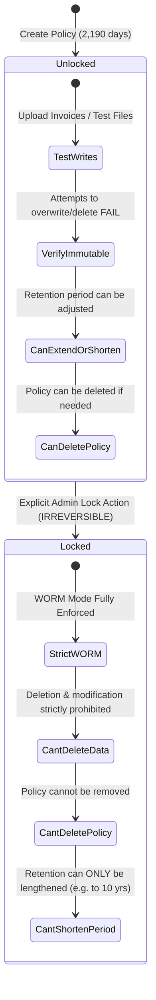

# Operational Guide: WORM Immutability Policy & Policy Lock Mechanics

> [!CAUTION]
> **READ CAREFULLY BEFORE EXECUTING A POLICY LOCK IN PRODUCTION**
> 
> Once an Azure Blob Storage immutability policy is **LOCKED**, it transitions into an irreversible state.
> **No one** — including the Azure Subscription Owner, Microsoft Global Administrator, or Microsoft Azure Support Engineering — has the technical or administrative capability to delete the policy, shorten the retention duration, or delete the protected storage containers or blobs until the retention timer has fully elapsed (e.g., 2,190 days / 6 years).

---

## 1. Immutability Policy Lifecycle: Unlocked vs. Locked

Azure Blob Storage provides two states for time-based retention policies:



### State Comparison Matrix

| Capability / Attribute | Unlocked State (Default in this IaC) | Locked State (Production Legal Mode) |
| :--- | :--- | :--- |
| **Blob Deletion Prohibited** | ✅ Yes (during retention period) | ✅ Yes (during retention period) |
| **Blob Overwrite Prohibited** | ✅ Yes | ✅ Yes |
| **Append Writes Allowed** | ✅ Yes (if configured) | ✅ Yes (if configured) |
| **Policy Can Be Deleted** | ✅ Yes (by authorized admin) | ❌ **NO (Impossible)** |
| **Retention Can Be Shortened** | ✅ Yes | ❌ **NO (Impossible)** |
| **Retention Can Be Extended** | ✅ Yes | ✅ Yes (can extend up to 146,000 days) |
| **Container Can Be Deleted** | ❌ Only if empty | ❌ Only if empty and retention expired |
| **Storage Account Can Be Deleted** | ❌ Prohibited if blobs are locked | ❌ Prohibited until all blobs expire |
| **Regulatory Validation (SEC 17a-4 / VeriFactu)** | ⚠️ Not considered fully compliant (policy is mutable) | ✅ **100% Legally Compliant (strict WORM)** |

---

## 2. Pre-Lock Safety Checklist

Before transitioning a container immutability policy from `Unlocked` to `Locked`, execute this checklist:

1. [ ] **Container Name & Path**: Confirm the container (`facturas` or `pedidos`) is named according to your corporate naming convention.
2. [ ] **Retention Duration**: Confirm `2190` days (6 years) is the intended period.
3. [ ] **Append Blobs Configuration**: Verify `allowProtectedAppendWrites = true` is enabled if your ERP appends audit records.
4. [ ] **Subscription & Billing**: Confirm the Azure subscription is under a stable enterprise agreement (EA / MCA / CSP) to prevent subscription cancellation while locked blobs exist.
5. [ ] **Test File Verification**: Upload a dummy invoice and verify that `az storage blob delete` or delete via portal is rejected with HTTP `409 BlobImmutableDueToPolicy`.

---

## 3. How to Lock the Policy

This repository provides automated scripts and configurations to execute the lock safely.

### Option A: Using the Provided Azure CLI Script (Recommended)

Run the dedicated interactive locking script:

```bash
cd azure-cli
./lock-immutability.sh \
  --resource-group rg-erp-storage-spaincentral-prod \
  --storage-account sterpspainprod01 \
  --container facturas
```

The script will:
1. Query the current policy and display retention days and current state.
2. Require typing the confirmation phrase: `CONFIRM-LEGAL-LOCK`.
3. Retrieve the policy `ETag` and invoke `az storage container immutability-policy lock`.
4. Validate that the state has transitioned to `Locked`.

---

### Option B: Using the PowerShell Script

```powershell
cd powershell
./Lock-ImmutabilityPolicy.ps1 `
  -ResourceGroupName "rg-erp-storage-spaincentral-prod" `
  -StorageAccountName "sterpspainprod01" `
  -ContainerName "facturas"
```

---

### Option C: Using Terraform

In `terraform/terraform.tfvars`:

```hcl
# Set to true ONLY when you are ready to apply the permanent legal lock
lock_immutability_policy = true
```

Then execute:
```bash
terraform plan
terraform apply
```

---

### Option D: Using Azure Portal

1. Navigate to your **Storage Account** $\rightarrow$ **Containers**.
2. Select the container (e.g., `facturas`).
3. Click **Access policy** in the left menu.
4. Under **Immutable blob storage**, locate the Time-based retention policy.
5. Click the `...` (More options) menu $\rightarrow$ **Lock policy**.
6. Type the number of days or confirm the warning dialog.
